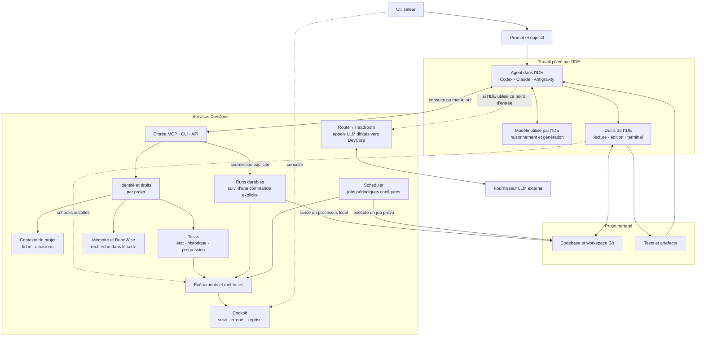

# DEV_CORE v10 - README

**SQLite Unifié & Engine Python Natif** — Plateforme d'orchestration IA pour le développement logiciel

Version : 10.2.0
Mode : Single Client (sans Docker)

## État de qualification — 14 octobre 2026

La migration globale DevCore est qualifiée pour le profil local PostgreSQL :

- `DevCoreIndividual` et `postgresql-x64-17` sont `Running` ;
- la release active est `devcore-py31316-20261013-postgres-v250` ;
- le cockpit individuel est disponible sur `http://127.0.0.1:20129/project` ;
- `/project` et `/api/status` répondent HTTP 200 ;
- le contrôle post-bascule compte 22 tests HTTP réussis, sans échec.

Le profil actif est le cockpit individuel. Les routes globales historiques
(`/` et `/api/dashboard`) sont fermées par conception ; les tâches nécessitent
une session authentifiée. Les preuves sont archivées dans
`docs/audit-2026-09-30/global-migration-final-status-2026-10-14.md`.

---

## 🚀 Lancement & Architecture

La plateforme s'exécute entièrement de manière native sur l'hôte à l'aide d'un moteur Python unifié (`devcore_engine`) et d'une base de données unique SQLite WAL (`devcore.db`). **Aucun conteneur Docker n'est requis.**

### Prérequis & Modules Externes
- **Python 3.13+**
- **Node.js >= 20.0.0**
- **Clés API** : Google Gemini et/ou Anthropic (définie dans `DEV_CORE_DATA\Security\gemini_api_key.txt` ou via le Cockpit)

#### 1. Dépendances Python
Pour installer les modules requis pour le fonctionnement du moteur et des API :
```powershell
pip install -r DEV_CORE\requirements-ci.txt
pip install -e DEV_CORE\
```

#### 2. Installation de Repowise
Repowise fournit l'intelligence de codebase et le serveur MCP local. Il doit être installé via pip :
```powershell
pip install "repowise[all]"
```

#### 3. Dépendances Node.js
Pour installer les outils de formatage et dépendances de développement web :
```powershell
cd DEV_CORE
npm install
cd ..
```

### Étape 1 : Configurer la CLI locale (Hôte Windows)
Pour utiliser le raccourci `dc` directement depuis votre console hôte Windows PowerShell :
```powershell
cd C:\devcore\DEV_CORE\Scripts
.\setup.ps1
```
*Note : Cela installe l'alias permanent `dc` pointant vers `dc.ps1`.*

### Étape 2 : Lancer la plateforme
Pour démarrer tous les services natifs en arrière-plan :
```powershell
python -m devcore_engine launch
# ou simplement :
dc launch
```
Cette commande :
- Valide ou migre la base de données unifiée `DEV_CORE_DATA/devcore.db`.
- Lance automatiquement les services en processus détachés silencieux :
  - **Dashboard API** sur le port `20129`.
  - **Gemini Router** sur le port `20130`.

### Étape 3 : Valider l'installation
```powershell
# Exécuter les diagnostics de santé et de conformité
dc check
```

---

## 🧭 Flux de travail IDE et DevCore

L'agent de l'IDE (Codex, Claude, Antigravity, etc.) garde la conduite du
raisonnement, des éditions et des outils. DevCore fournit des services locaux
qu'il consulte ou déclenche : contexte de projet, tâches, mémoire du code,
routage LLM, exécution de commandes et observabilité.



Les flèches pointillées représentent des intégrations optionnelles. Un run
DevCore peut exécuter une commande locale explicitement soumise, mais il ne
démarre pas automatiquement une session d'agent dans l'IDE.

---

## 📋 Workflow Tasks

```powershell
# Créer une tâche
dc new task "Implémenter API REST" -reasoning

# Charger la tâche active
dc next task

# Travailler...
git commit -m "feat: add REST endpoints [T-01]"

# Valider la tâche
dc task done

# Voir le statut
dc task status
```

---

## 🎯 Modes Cognitifs & Gemini Router

La plateforme utilise un routeur intelligent (**Gemini Router** sur le port `20130`) qui intercepte les requêtes LLM locales, analyse l'intention cognitive et redirige l'exécution vers le modèle optimal selon le mode requis :

| Mode | Usage | Budget Contexte | Modèle Google Gemini Cible |
|------|-------|-----------------|-----------------------------|
| **reasoning** | Architecture, spécifications, décisions critiques | 32k tokens | Gemini 2.5 Pro |
| **coding** | Implémentation de code, cycle TDD, génération de patches | 8k tokens | Gemini 2.5 Pro |
| **bulk** | Génération de masse, documentation, écriture de tests unitaires | 16k tokens | Gemini 2.5 Flash |

Le routeur gère automatiquement le rate-limiting (retries avec backoff exponentiel sur erreur 429).

---

## 📁 Structure du Projet

```text
C:\devcore\
├── DEV_CORE\                   # Code source de la plateforme (Python Engine)
│   ├── devcore_engine\         # Package Python unifié (db, services, lifecycle, hooks)
│   ├── API\                    # FastAPI API
│   ├── Bus\                    # Bus d'événements interne
│   ├── Config\                 # Fichiers de configuration (AGENTS.md, CLAUDE.md, BOOT.md)
│   ├── Dashboard\              # Rendu du Cockpit (template.html & template_terminal.html)
│   ├── Scripts\                # Scripts orchestrateurs
│   └── tests\                  # Suite de tests unitaires (pytest)
├── DEV_CORE_DATA\              # Répertoire de données persistant
│   ├── devcore.db              # Base de données unique SQLite WAL & sqlite-vec (768d)
│   ├── Logs\                   # Journaux d'exécution
│   └── Obsidian\               # Vault Obsidian des notes de l'agent
└── README.md                   # Ce fichier
```

## 🔗 Ports & Services

Voici la cartographie des ports réseau utilisés par les différents services de la plateforme DevCore :

| Port | Service | Description | Statut |
|------|---------|-------------|--------|
| **7337** | Repowise API | Indexation intelligente, graphe de connaissances et dead-code | ✅ Actif |
| **8787** | Headroom Proxy | Proxy local pour la journalisation et le contrôle des coûts | ✅ Actif |
| **8788** | Anthropic Adapter | Adaptateur de protocole Anthropic -> Headroom -> OpenAI | ✅ Actif |
| **20129** | Dashboard/Cockpit API | API et serveur web du Cockpit (FastAPI) | ✅ Actif |
| **20130** | Gemini Router | Proxy intelligent d'inférence avec rate-limiting et modes cognitifs | ✅ Actif |
| **20131** | API Principale | API backend de DevCore (FastAPI) | ✅ Actif |
| **30000** | Web Frontend | Interface web Next.js / React (accessible via Docker) | ✅ Actif |

---

## 🔧 Commandes principales

### Tâches
- `dc next task` — Charge la prochaine tâche.
- `dc task done` — Valide + sync la mémoire.
- `dc task status` — Affiche le statut.
- `dc new task [titre] -[mode]` — Crée une tâche.

### Cycle & Plateforme
- `dc launch` — Démarrage de la journée et des démons.
- `dc check` — Diagnostic complet via le moteur de diag unifié.
- `dc check --gate` — Diagnostic release gate avec code de sortie.
- **Tests Unitaires (Cross-platform)** :
  - Sur Windows/Linux : `python -m unittest discover -s devcore_engine/tests`
  - Sur Ubuntu : `python3 -m unittest discover -s devcore_engine/tests`


---

## 📊 Cockpit Dashboard

**État du service individuel L9 sur ce poste (11 octobre 2026)** :
`http://127.0.0.1:20129/project` sert la page de connexion du profil de recette.
Le Cockpit historique sur `/` et `/index_terminal.html` répond HTTP 403 dans ce profil.
Le magasin d'identité actif est encore au schéma 1, sans comptes ni sessions navigateur :
la page individuelle affiche « Service indisponible » jusqu'à la migration explicite
de l'identité et au provisionnement d'un compte local autorisé pour un projet.
Le mot de passe Windows n'est pas un identifiant DevCore.

**Pilote sur copie (11 octobre 2026)** : `http://127.0.0.1:20132/project` ouvre
une interface individuelle distincte. Utiliser le projet `devcore`, l'utilisateur
`majdi` et le mot de passe DevCore défini dans la fenêtre locale à saisie masquée.
Le compte a le rôle `contributor` sur les 29 projets du snapshot (l'archive
technique exclue). La session porte sur un seul projet à la fois ; changer de
projet demande une nouvelle connexion avec son identifiant exact. Les tâches
et toute modification effectuée à cette adresse restent dans la copie de
qualification, sans effet sur l'instance active. Ce processus pilote n'est pas
un service à démarrage automatique ; l'adresse `20129` reste inchangée.
Si ce processus manuel doit être relancé, la copie republiée et vérifiée
`E:/DevCoreRuntime/qualification/clean-releases-v241/runtime/releases/devcore-py31316-20261011-l9-runfix-clean-v241`
contient son propre bundle propre. Son précontrôle réussit sur les racines du
pilote ; le processus déjà lancé sur 20132 continue de répondre. La copie
v241 reste un artefact de qualification, sans installation dans le service SCM.

**Aperçu du Cockpit historique sur copie (11 octobre 2026)** :
`http://127.0.0.1:20134/` ouvre la vue graphique et
`http://127.0.0.1:20134/index_terminal.html` ouvre la vue terminal de l'ancien
Cockpit. Le snapshot contient les 1 378 tâches de la copie de qualification ;
les projections affichées sont figées, avec un bandeau « lecture seule ».
Le serveur d'aperçu refuse les écritures (HTTP 405), ne fournit ni session
individuelle ni télémétrie en direct et n'est pas enregistré pour démarrer avec
Windows. Pour lire et modifier les tâches de la copie avec le compte `majdi`,
utiliser toujours l'interface individuelle sur le port 20132.

Les adresses ci-dessous concernent le profil Cockpit historique, lorsqu'il est lancé
dans un environnement où ses routes sont autorisées :

Ouvrir dans un navigateur :
- **Mode Cockpit** (Design graphique moderne) : `http://127.0.0.1:20129/`
- **Mode Terminal** (Scanline vert/cyan) : `http://127.0.0.1:20129/index_terminal.html`

### Fonctionnalités Clés :
- **SQLite Vector DB** : Statut de la base virtuelle `sqlite-vec` surveillé en direct.
- **Supervision Headroom & Télémétrie Unifiée** : Suivi persistant des sessions et tokens. Intègre à la fois l'activité automatisée de DevCore et le chat interactif direct de l'IDE Antigravity (via le client virtuel `headroom-proxy` et l'analyse de transcripts).
- **Filtrage par Projet** : Sélection par projet avec ré-indexation dynamique du graphique.
- **Configuration Unifiée** : Synchronisation des clés d'API et clients actifs.
- **Optimisation SQLite & Silence Logs** : Avertissements d'importation de `sqlite-vec` réduits au silence via des variables d'environnement ciblées (`SQLITE_VEC_NO_WARN=1`) pour des diagnostics et logs 100% propres.
- **Détails & Actions Intuitives** : Affichage exclusif de la check-list des étapes de tâches et des descriptions au sein du pop-up interactif du bouton *Détails*, préservant la compacité et la lisibilité du tableau de bord.

---
