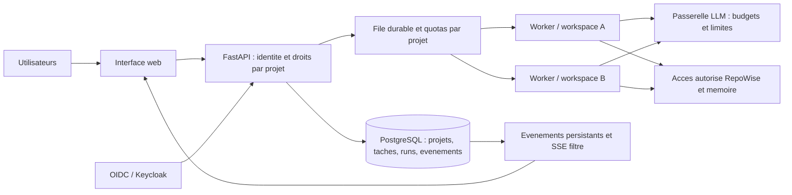

# DevCore : audit et trajectoire multi-utilisateur

Date : 30 septembre 2026. Dépôt : `E:/src_python/devcore`, HEAD `b2349de`.

## Avis

DevCore constitue une base utile d'automatisation personnelle : services Python, contrats d'API, bus persistant, outils de diagnostic, mémoire hybride, intégration RepoWise et tests. Son architecture réelle reste celle d'un poste partagé autour d'un état global. L'objectif « chaque utilisateur travaille sur son projet sans bloquer les autres » exige de changer les frontières d'identité, de stockage et d'exécution.

Je recommande une évolution progressive vers un **monolithe modulaire FastAPI avec PostgreSQL, authentification OIDC et workers isolés**. Un moteur d'exécution durable doit posséder la reprise, les tentatives et les délais. Conserver SQLite pour une édition personnelle reste pertinent. La version équipe nécessite une qualification distincte.

## Méthode et limites

- Lecture du code de l'API, du Cockpit, des tâches, sessions, schémas, runners, mémoire, MCP et tests.
- Interaction DevCore : `GET /api/status`, lecture des tâches du Cockpit et appel local du handler `devcore_task_status` : 384/389 tâches terminées, aucune tâche active selon ce handler. Ce statut provient de sa projection JSON.
- Interaction **MCP RepoWise réelle**, par son transport stdio configuré : `get_overview`, `get_health`, `get_context`, ciblés sur `devcore`. Réponses sauvegardées dans ce dossier.
- Vérification REST RepoWise par l'identifiant du dépôt `cdaa60a23d384c79a3cd819c12469a7f`.
- 59 tests ciblés réussis en 14,60 s : API entière, services tâches et événements, runners. Rapport JUnit : `pytest.xml`. Cette sélection ne constitue pas toute la CI.
- Reproductions avec bases et répertoires temporaires ; aucune correction du code applicatif ni migration des données réelles.
- Recherche externe dans les dépôts et documentations officiels. Les recommandations constituent des choix d'architecture ; leurs gains ne sont pas des mesures de production.
- Aucun test de charge sur le service réel. Le nombre d'utilisateurs, les dépôts, le matériel et les budgets LLM restent à dimensionner.

## Constats prioritaires

| Priorité | Constat et preuve | Conséquence | Action |
|---|---|---|---|
| P0 | `tasks.py:99,214,235,266,294` : plusieurs lectures/écritures utilisent seulement `id`, mais `db.py:160` définit `(id, project_id)` comme clé primaire. Reproduction : modifier `T-01` pour A change aussi le titre de B. | Modification croisée de projets, même si les utilisateurs choisissent correctement leur projet. | Identité interne globale des tâches ; numéro d'affichage par projet ; filtrage obligatoire par projet et contrôle des droits à chaque opération. |
| P0 | `session.py:26-51` : clé globale `runtime_state.active_project`. Deux gestionnaires partageant le stockage voient le dernier projet sélectionné. | Actions et mémoire rattachées au mauvais contexte. | Contexte explicite `user_id / project_id / session_id / run_id`, transmis de bout en bout. |
| P0 | `dashboard_api.py:438,463,998,1059` : routes dashboard publiques et jeton commun injecté dans les pages HTML. Lecture réelle des tâches sans Authorization : HTTP 200. L'API `devcore_api/app.py` ne définit pas d'authentification utilisateur sur ses lectures. | Le filtrage par projet ne constitue pas un contrôle d'accès. Conception locale incompatible avec une ouverture à plusieurs utilisateurs. | OIDC, sessions individuelles, droits par projet, restrictions du flux SSE et des recherches. |
| P1 | `dashboard_api.py:697,976,1135` : `subprocess.run` accessible directement depuis des fonctions `async`. Reproduction isolée : travail synchrone simulé de 200 ms, coroutine concurrente retardée d'environ 201 ms. | Une génération de tableau de bord bloque la boucle du processus API ; plusieurs clients SSE peuvent déclencher des régénérations. | Travaux longs en file ; API répondant 202 ; producteur d'événements unique et diffusion aux abonnés autorisés. |
| P1 | `db.py:169,196,210` : références vers `tasks(id)` alors que `id` seul n'est pas unique. Insertion d'un run dans une base neuve : `foreign key mismatch`. | Le schéma ne permet pas le parcours run/tâche attendu avec intégrité référentielle activée. | Migration explicite des clés et références ; tests avec données de deux projets. |
| P1 | `worker.py:61-64` vérifie le délai après le retour du handler. Reproduction : délai de 20 ms, retour après 200 ms. | Un handler bloqué ne sera jamais interrompu par ce délai. | Délai effectivement imposé au processus, arrêt de l'arbre de processus, lease et reprise. |
| P1 | `hermes_runner.py:28-36` simule le travail avec `asyncio.sleep` puis retourne success ; `process_runner.py:72` retourne True pour checkpoint sans persistance. | L'autonomie et la reprise ne sont pas démontrées par ces adaptateurs. | Branchements réels, checkpoints persistés, essais de redémarrage pendant les étapes. |
| P1 | `process_runner.py:30` lance un shell sans `cwd` ni environnement propres au projet. | Un sous-processus partage les permissions et le contexte de l'hôte ; ce n'est pas une sandbox de sécurité. | Workspace et environnement explicites ; conteneur/VM sous identité limitée ; secrets et ressources propres au run. |
| P1 | `memory_hierarchy.py:88-109` recherche les conversations sans filtre d'accès projet ; `dashboard_api.py:1150` envoie un vecteur nul de dimension 384, tandis que le contrat embedding annonce 768. | Fuite de contexte possible entre projets ; recherche sémantique du Cockpit non représentative de la requête. | ACL avant recherche, fournisseur réel d'embeddings, contrats dimension/modèle, corpus d'évaluation. |

Le défaut de tâches est confirmé dans `TaskService`. Certaines opérations du Cockpit possèdent leur propre implémentation SQL : il ne faut pas attribuer automatiquement le même défaut à chaque route. Cette duplication justifie de faire converger CLI, MCP et HTTP vers les mêmes services.

### Cohérence et modularité

`TaskService` valide les données puis publie un événement dans une transaction distincte. Son export JSON est direct et les exceptions sont ignorées. L'API principale lit encore des fichiers via `FileTaskRepository`. Il existe donc plusieurs représentations pouvant diverger. Une table outbox est déjà définie : la présence de ce schéma ne prouve pas que les mutations des tâches l'utilisent.

Adopter une source de vérité SQL, une transaction commune mutation + événement et des projections reconstruites par un consommateur idempotent. Les JSON deviennent des exports versionnés. Prévoir pagination, rétention et écriture atomique des exports.

Le point d'entrée `DEV_CORE/MCP/devcore-scripts/server.py` affiche une liste de handlers puis termine ; il ne lance pas un transport MCP. Les handlers sont réutilisables, mais le service défini dans Compose doit être remplacé par un serveur protocolaire réel et testé avec initialize/list_tools/call_tool. Pendant cet audit, DevCore a été interrogé par HTTP et dispatch local ; RepoWise a bien été interrogé en MCP.

### État vérifié des services et de RepoWise

- Cockpit 20129 : réponse positive. Cela démontre sa disponibilité HTTP, pas celle de toutes ses dépendances.
- API 20131 : connexion refusée lors du contrôle. Le README la présente pourtant comme active.
- RepoWise REST 7337 : version annoncée 0.52.0.
- Index DevCore : commit identique à HEAD, âge signalé de six jours ; santé stockée datée du 23 septembre, provenance du commit d'analyse non enregistrée.
- Santé agrégée stockée : 7,9/10 ; fichiers tâches 1/10, base 1,09/10, Cockpit 1,85/10. Ce sont des heuristiques de triage, pas des mesures de performance ni une certification.
- Coordinateur : 963 pages SQL contre 452 vecteurs de pages ; dérive 53,06 %, statut critical. Décisions : 19 contre 12 vecteurs.
- MCP : `embedder=mock`, `semantic_search=false`. Couverture ingérée absente ; des tests existent et ont été exécutés pendant cet audit.
- Fermeture du client MCP : avertissements de finalisation de connexions et, lors du premier essai, panique d'un worker LanceDB. Les réponses ont été obtenues, mais le cycle de vie du processus mérite un test dédié avec versions figées.

La remise en état de RepoWise doit cibler ce dépôt, vérifier index lexical/vectoriel, fournisseur d'embeddings et références au commit, puis tester de vraies requêtes connues. Un simple message « index à jour » ne suffit pas.

## Architecture cible

### Invariants

1. L'utilisateur authentifié provient du serveur d'identité. Le serveur vérifie son appartenance au projet ; un `project_id` fourni par le navigateur ne suffit pas.
2. Chaque run possède un identifiant global, un workspace, des secrets limités, un budget, un délai et une trace. Le numéro `T-01` reste un libellé propre au projet.
3. Une requête longue enregistre un run et renvoie rapidement 202. Aucun appel LLM, Git ou génération complète ne reste dans la boucle HTTP.
4. La concurrence globale est bornée, avec plafond par utilisateur et projet. Une politique d'équité empêche le projet A de consommer tous les créneaux. Le partage d'une clé fournisseur exige aussi une limite globale LLM.
5. Une seule écriture Git par worktree à la fois ; les projets indépendants progressent simultanément. Un worktree isole les fichiers Git, pas les permissions du système.
6. Les reprises sont au moins une fois : déduplication et clés d'idempotence sur les effets externes. Une PR déjà créée doit être retrouvée après panne. Un journal durable seul ne garantit pas l'unicité d'un effet extérieur.
7. Les caches incluent projet, permissions, commit et version du modèle. Les recherches lexicales, vectorielles et graphes respectent les mêmes droits. Le filtrage après récupération n'est pas une frontière de sécurité suffisante.
8. Une exécution est « réussie » après validation des résultats et artefacts. Les actions permises sont définies par politique ; une sortie LLM ne peut pas élargir ses permissions.

SQLite WAL autorise les lecteurs en parallèle avec un écrivain, mais conserve un seul écrivain à la fois. Il peut convenir à une petite installation ; il ne corrige ni les collisions de contexte ni les droits manquants. Pour une édition équipe avec plusieurs workers, je privilégie PostgreSQL. [Documentation SQLite](https://www.sqlite.org/wal.html)

Ajouter des politiques RLS sur les tables métier avec un rôle applicatif sans BYPASSRLS et une gestion correcte du contexte par transaction. Le propriétaire des tables et certains rôles privilégiés peuvent contourner RLS : les tests doivent utiliser le vrai rôle applicatif. RLS complète les droits applicatifs. [PostgreSQL](https://www.postgresql.org/docs/current/ddl-rowsecurity.html)

## Projets open source à privilégier

| Projet | Utilité concrète pour DevCore | Choix conseillé et limites |
|---|---|---|
| [DBOS Python](https://github.com/dbos-inc/dbos-transact-py) — MIT | Workflows, étapes persistées et files adossées à une base. | Premier prototype conseillé : intégration naturelle au Python existant et nombre limité de services supplémentaires. Tester explicitement la reprise distribuée, le versionnement et les effets externes. |
| [Temporal](https://github.com/temporalio/temporal) — MIT | Orchestration durable séparée des workers. | Alternative si la plateforme doit opérer plusieurs serveurs et beaucoup de workflows longs. Coût d'exploitation et discipline du code workflow supérieurs ; décider avec un prototype comparable. |
| [Keycloak](https://github.com/keycloak/keycloak) — Apache-2.0 | Identité centralisée, fédération, authentification et gestion des utilisateurs. | Réutiliser l'IdP existant s'il existe. Implémenter les appartenances et droits par projet dans DevCore. |
| [Coder](https://github.com/coder/coder) — AGPL-3.0 pour le socle | Provisionnement d'environnements de développement et d'agents. | Intéressant si chaque utilisateur doit disposer d'un environnement distant complet. Une sandbox par run peut suffire au départ ; distinguer fonctions communautaires et commerciales. |
| [LangGraph](https://github.com/langchain-ai/langgraph) — MIT | Graphe d'étapes agentiques, état persistant et intervention humaine. | Utile pour les parcours analyser → modifier → tester → corriger. Définir un propriétaire unique de chaque niveau de reprise si associé à DBOS ou Temporal. |
| [LiteLLM](https://github.com/BerriAI/litellm) | Passerelle commune, routage et suivi des appels modèles. | Comparer avec Gemini Router/Headroom/adapter existants pour consolider les responsabilités. Valider les fonctions de quotas de l'édition choisie avant adoption. |
| [pgvector](https://github.com/pgvector/pgvector) | Recherche vectorielle proche des métadonnées et permissions SQL. | Candidat pour la mémoire de DevCore ; conserver RepoWise comme service distinct. Mesurer rappel et latence avec filtres projet. Les index approximatifs partagés peuvent affecter le rappel entre tenants. |
| [OpenTelemetry](https://opentelemetry.io/docs/what-is-opentelemetry/) et [Langfuse](https://github.com/langfuse/langfuse) | Traces système, suivi et évaluation des appels LLM. | Exploiter les contrats de corrélation déjà présents. L'actuel client Langfuse peut simplement bufferiser en mémoire sans transport : le branchement réel reste à qualifier. |
| [uv](https://github.com/astral-sh/uv) | Environnements et dépendances Python reproductibles. | Unifier les dépendances et verrouiller les versions. Le pyproject actuel ne déclare que sqlite-vec, tandis que FastAPI et MCP arrivent par requirements-ci. |

DBOS propose notamment des limites de concurrence par partition, utiles pour une partition par projet, en plus des plafonds globaux. Elles ne dispensent pas de vérifier l'équité sous saturation. Sa documentation recommande PostgreSQL en production et propose SQLite pour démarrer. [Files DBOS](https://docs.dbos.dev/python/reference/queues), [guide Python](https://docs.dbos.dev/python/programming-guide)

LiteLLM documente les budgets et limites par utilisateur/équipe/clé ; leur périmètre exact et les options d'édition doivent correspondre au besoin. [Documentation](https://docs.litellm.ai/docs/proxy/users)

Je recommande de sélectionner **un** moteur durable après comparaison. L'installation simultanée de plusieurs orchestrateurs augmenterait le nombre de règles de reprise à maintenir. L'augmentation du nombre d'agents n'est intéressante qu'après mesure de la qualité, du coût et de la contention.

## Techniques et fonctionnalités à développer

- **Exécution durable** : checkpoints par étape, reprise après panne, délai réellement appliqué et annulation de l'arbre de processus.
- **Ordonnancement équitable** : files par projet ou partitions, quotas pondérés, âge des tâches, limite des tentatives et mise à l'écart des échecs persistants.
- **Outbox transactionnelle** : changement métier et événement dans la même transaction ; consommateurs idempotents et replay pour reconstruire le tableau de bord.
- **SSE avec reprise** : identifiants d'événements, `Last-Event-ID`, rétention, curseur et filtrage des abonnements ; une régénération par changement utile.
- **Recherche hybride évaluée** : conserver le principe lexical + vecteurs + RRF déjà présent ; ajouter provenance fichier/commit, vrais embeddings et éventuellement reranking après mesures.
- **Indexation incrémentale** : traitement des fichiers modifiés, regroupement des notifications, exclusion des artefacts et backpressure pour éviter qu'une indexation monopolise le poste.
- **Agent autonome vérifiable** : résultat attendu, tests, artefacts, journal des outils, budget de réparation, arrêt au dépassement et passage en attente explicite.
- **Module remplaçable** : interfaces `TaskRepository`, `WorkflowEngine`, `Runner`, `ModelGateway`, `KnowledgeProvider` ; adaptations CLI/HTTP/MCP fines et contrats versionnés.
- **Environnements à la demande** : templates de workspace, expiration des environnements inactifs, limites CPU/RAM et stockage des résultats hors du processus agent.

## Feuille de route avec critères de sortie

| Phase | Travail | Critère de sortie |
|---|---|---|
| 1 — Intégrité | Corriger clés des tâches et FK, contexte session explicite, tests à deux projets ; migration sauvegardée et vérifiée. | Aucune lecture ou mutation croisée pour deux projets portant les mêmes numéros de tâches. |
| 2 — Identité | OIDC, membres et rôles par projet, API commune, droits sur mémoire, RepoWise et SSE. | Un utilisateur de A ne peut obtenir ni contenu, ni événement, ni résultat de recherche de B. |
| 3 — Exécution | Prototype DBOS/PostgreSQL face à Temporal selon cible ; API 202, quotas et workers isolés. | Arrêt d'un worker pendant un run, reprise vérifiée, absence de double effet externe et progression de B quand A sature. |
| 4 — Cohérence | Source SQL, outbox, projections, SSE avec replay ; consolidation Cockpit/API/MCP. | Après interruption ou reconnexion, les données affichées convergent vers l'état SQL sans perte d'événement. |
| 5 — Intelligence et exploitation | Embeddings réels, réparation RepoWise ciblée, évaluation recherche, traces et coûts ; sauvegarde/restauration. | Recherche évaluée sur corpus, restauration testée et traces corrélées de l'API au worker. |

Ordres de grandeur à discuter : 1 à 2 semaines pour intégrité et contexte, puis 3 à 6 semaines pour un pilote équipe limité avec identité, file et workers. Ce sont des estimations de planification pour un développeur connaissant le dépôt, pas un engagement ; migrations, exigences d'isolation et infrastructure peuvent allonger le travail.

### Qualification proposée

Scénario initial : 20 utilisateurs simulés sur 20 projets, quatre exécutions actives, saturation d'un projet, deux identifiants de tâche identiques, reconnexion SSE et crash d'un worker. Rejouer ensuite à la volumétrie réelle.

Cibles à négocier puis mesurer : p95 lectures interactives inférieur à 300 ms, enregistrement durable d'un run inférieur à 500 ms, progression observable de chaque projet admis, zéro accès croisé, zéro double effet externe dans les scénarios de reprise. La réponse LLM a un budget de latence distinct. Mesurer aussi mémoire, CPU, délai de file, latence de la boucle événementielle, verrous SQL, erreurs et coût par run réussi.

Le benchmark existant `Performance/devcore_load.py` utilise notamment un repository simulé et des requêtes séquentielles. Il ne démontre pas ces propriétés de concurrence. Les 59 tests passants sont un socle utile, à compléter par ces scénarios réels.

## Fichiers d'appui

- `reproduce_findings.py` : reproductions isolées des mutations croisées, contexte global, FK, délai worker et blocage asynchrone.
- `reproductions.json` : sortie de ces reproductions.
- `pytest.xml` : résultat des 59 tests ciblés.
- `get_overview.json`, `get_health.json`, `get_context.json` : réponses MCP RepoWise obtenues pendant l'audit.

Le socle à retenir pour le pilote est FastAPI + PostgreSQL + identité OIDC + un moteur durable + workspaces isolés. La priorité est l'intégrité des projets, puis la réactivité, puis l'autonomie vérifiée par des essais de panne.
