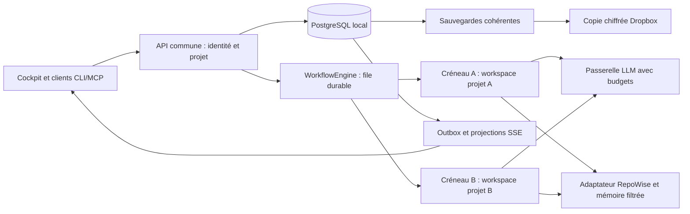

# Plan d'implémentation DevCore local et multi-utilisateur

Date : 1er octobre 2026.
Statut : exécution commencée le 1er octobre ; L0 en cours et premiers correctifs L1 implémentés. Voir [journal d'exécution](../docs/audit-2026-09-30/execution-2026-10-01.md).
Référence : [audit du 30 septembre](../docs/audit-2026-09-30/rapport.md).

## 1. Objectif et périmètre

Déployer sur ce poste une instance DevCore qui centralise les données, permet à plusieurs utilisateurs de travailler sur leurs projets, conserve une interface réactive pendant les traitements et reprend les travaux après interruption.

Le développement commence en accès localhost. L'accès au réseau local constitue un jalon distinct, après validation des identités, des droits et de l'isolation. L'accès Internet pourra être ajouté ultérieurement. Les agents continuent d'utiliser les fournisseurs LLM configurés : hébergement local ne signifie pas inférence locale ni fonctionnement sans réseau.

Le plan guide les corrections et la migration. Les premiers correctifs et sauvegardes sont consignés dans le journal d'exécution ; la bascule PostgreSQL et la synchronisation Dropbox n'ont pas été modifiées.

## 2. État de départ vérifié

| Élément | Observation du 1er octobre | Conséquence |
|---|---|---|
| Poste | Windows 10 Professionnel x64 | Prévoir un prérequis de maintenance et de mises à jour de l'OS avant un accès réseau. |
| CPU | Intel i5-7400, 4 cœurs / 4 processeurs logiques | Commencer avec deux créneaux d'exécution, un par projet. |
| RAM | Environ 15,9 Gio utilisables, 4,8 Gio libres au contrôle | Mesurer le pic réel ; borner les workers et l'indexation. |
| Disques | C: environ 12,2 Gio libres ; E: environ 187,7 Gio libres | Placer données, workspaces, environnements et sauvegardes temporaires sur E:. |
| Outils | Python 3.14, commandes Docker et WSL trouvées ; psql et Podman absents du PATH | La présence des commandes ne prouve pas qu'un moteur Docker/WSL fonctionne. PostgreSQL installé ou actif reste à inventorier. |
| Dépôt | Modifications préexistantes des deux fichiers Dashboard/index*.html ; dossier d'audit non suivi | Préserver ces modifications et isoler les commits d'implémentation. |
| Code | Filtres de tâches incomplets, projet global, FK invalides et runner Hermes simulé toujours présents | L'audit reste exploitable comme base du plan. |
| Validation passée | 59 tests ciblés passaient le 30 septembre | Référence historique, pas une validation du 1er octobre ni de la cible. |

## 3. Architecture retenue pour le pilote

Décisions de planification :

- Monolithe modulaire Python/FastAPI, avec processus API et workers distincts.
- PostgreSQL local comme source de vérité du profil équipe. SQLite sert au correctif initial et à l'import de l'historique ; ne pas maintenir deux bases actives pour une même instance.
- PostgreSQL et processus Python natifs Windows privilégiés afin de limiter l'empreinte du pilote. Qualifier les versions et dépendances avant installation ; installer un environnement propre, sans modifier le Python global utilisé par d'autres projets.
- DBOS comme candidat d'exécution durable, derrière une interface WorkflowEngine. Sa sélection devient définitive après le prototype du lot L5. Aucun service cloud DBOS requis par le plan.
- Comptes individuels locaux pour le premier pilote, via des composants d'authentification maintenus ; interface IdentityProvider permettant OIDC ensuite. Keycloak/OIDC devient une extension si un annuaire ou SSO est requis.
- Cockpit actuel conservé comme interface initiale. Ses routes deviennent des adaptateurs de l'API métier ; le backend de référence est l'API versionnée sur 20131. Le port 20129 sert temporairement l'interface et la compatibilité. Les ports internes restent liés à localhost.
- RepoWise conserve son index et son cycle de vie. DevCore l'appelle via un adaptateur qui contrôle les projets accessibles.
- Une passerelle LLM conserve les fournisseurs existants et applique quotas, délais et budgets par projet ; le remplacement par LiteLLM reste conditionné à un besoin mesuré.
- Les processus natifs conviennent aux tâches de confiance. L'exécution de code arbitraire par des utilisateurs non fiables exige une sandbox qualifiée dans une VM/conteneur séparé ; un worktree ou un cwd distinct n'est pas une frontière de sécurité.

Répertoires proposés, à valider dans L0 :

| Usage | Emplacement proposé |
|---|---|
| Données actives du serveur, journaux et cache | E:/DevCoreRuntime/data |
| Données PostgreSQL | E:/DevCoreRuntime/postgres |
| Workspaces de travail | E:/DevCoreRuntime/workspaces/<project_uuid>/<run_uuid> |
| Artefacts conservés | E:/DevCoreRuntime/artifacts/<project_uuid>/<run_uuid> |
| Sauvegardes avant copie externe | E:/DevCoreRuntime/backups |
| Environnements et installation versionnée | E:/DevCoreRuntime/releases/<version> |
| Documents partagés / exports | DEV_CORE_DATA Dropbox existant, chemin réel inventorié dans L0 |

Séparer explicitement racine des documents et racine transactionnelle. Vérifier la résolution des chemins et les ACL Windows. Une copie sur le même disque n'est pas une sauvegarde indépendante ; Dropbox reçoit seulement les archives terminées et chiffrées. Les clés de déchiffrement sont conservées séparément.

## 4. Ordre et dépendances

Chemin principal : **L0 → L1 → L2 → L3 → L4 → L5 → L6 → L7 → L8 → L9**.

La protection des services localhost et l'arrêt des accès anonymes sont préparés dès L2. L3 reste en environnement de recette jusqu'à la validation de L4. L'accès réseau attend L9. Chaque lot donne lieu à un changement révisable avec ses tests et un résultat consigné ; le lot suivant ne masque pas un critère de sortie en échec.

| Lot | Livrable principal | Charge indicative |
|---|---|---|
| L0 | Inventaire, sauvegarde restaurée et environnement reproductible | 1–2 jours |
| L1 | Intégrité des tâches et contexte de session explicite | 3–5 jours |
| L2 | Services métier communs et adaptateurs HTTP/CLI/MCP | 3–5 jours |
| L3 | PostgreSQL, migrations et source de vérité unique | 4–6 jours |
| L4 | Comptes, sessions et droits par projet | 4–6 jours |
| L5 | File durable, reprise, annulation et quotas | 5–8 jours |
| L6 | Outbox, projections et SSE sans blocage | 3–5 jours |
| L7 | Mémoire et RepoWise fiables et cloisonnés | 3–5 jours |
| L8 | Autonomie vérifiable et supervision | 3–5 jours |
| L9 | Qualification et déploiement local | 3–5 jours |

Total indicatif : **32–52 jours de travail**, soit environ 7–11 semaines pour une personne disponible à plein temps. Réestimer après L0 et L5. Les anomalies des données existantes, les dépendances Windows et une isolation forte des runners peuvent augmenter cette charge. Les corrections P0 arrivent avant l'ensemble des fonctionnalités.

## 5. Lots détaillés

### L0 — Préparer une migration réversible

- [x] Inventorier les chemins effectivement utilisés, bases SQLite, JSON, notes, configurations, index RepoWise, planificateurs et processus ; produire un [manifeste sans valeurs de secrets](../docs/audit-2026-09-30/inventaire-local-2026-10-02.md). Les écrivains d'autres postes restent à identifier au point suivant.
- [x] Identifier les autres postes qui écrivent encore dans Dropbox et [préparer la fenêtre de gel](../docs/audit-2026-09-30/preparation-gel-2026-10-02.md). Les copies de code et de `DEV_CORE_LOCAL` fournies par l'utilisateur ont été [comparées en lecture seule](../docs/audit-2026-09-30/copie-locale-autre-poste-2026-10-02.md). Il a ensuite précisé « non pas d'autre poste » : le pilote ne dépend d'aucun autre poste actif. La synchronisation Dropbox et l'arrêt des écrivains actuels seront vérifiés lors de la fenêtre réelle en L9 ; la synchronisation continue des documents peut subsister.
- [x] Copier SQLite avec une méthode de sauvegarde cohérente, exporter les JSON et vérifier une restauration dans un dossier temporaire. Les divergences d'intégrité sont recensées dans le journal ; l'inventaire des copies conflictuelles reste à faire.
- [x] Capturer les versions et isoler les dépendances dans un [environnement Python 3.13 Windows verrouillé](../docs/audit-2026-09-30/environnement-python-2026-10-02.md). Les dépendances runtime/test sont regroupées dans `pyproject.toml`, avec verrou SHA-256 et 22 tests en recette ; la CI distante et les composants optionnels restent à qualifier avant la bascule des services actifs.
- [x] Réexécuter les reproductions de l'audit et les tests ciblés dans des données temporaires ; relever [mémoire des services, CPU au repos, taille des index et latences SQLite](../docs/audit-2026-09-30/reference-performance-2026-10-02.md). Les 28 tests ciblés passent ; les mesures sont ponctuelles, et la charge concurrente et les pics restent à qualifier en L9.
- [x] Documenter les paramètres du [profil local](../docs/audit-2026-09-30/profil-local-2026-10-02.md), relever les ports et vérifier les prérequis OS/Docker/WSL sans supposer leur disponibilité. Les ports déclarés sont occupés par les services actuels, 20131 n'écoutait pas au relevé, Docker n'a pas de moteur joignable et PostgreSQL reste à installer en L3 ; revérifier juste avant tout démarrage.

Fichiers : pyproject.toml, requirements-ci.txt, Scripts/rotate_logs_and_backups.py, Scripts/verify.ps1 ; nouveaux manifeste, procédure de restauration et configuration d'exemple sans secrets.

Sortie : sauvegarde restaurée et comparée, chemins confirmés, test de référence enregistré, migration réelle encore inactive.

Complément du 3 octobre : les résolveurs Python de racines explicites ne
redirigent plus une configuration absente du disque ou historiquement nommée
vers Dropbox/le stockage par défaut. Valeurs vides et fichiers refusés ; parents
locaux créés au chemin demandé, erreurs propagées avant ouverture de base.
**45 tests distincts réussis** (14 nouveaux cas, isolation et HTTP individuel),
avec métadonnées Dropbox factices et racines temporaires. Le profil local
documente la compatibilité : autodétection seulement pour une variable absente,
chemins relatifs conservés, absence de sandbox/interdiction de Dropbox explicite.
Les autres résolveurs, sous-processus et configurations actives restent à vérifier
en L9 ; aucune bascule ni qualification globale n'est déduite de ce correctif.

Passage v164 : `platform_version.ps1` ne remplace plus une racine `DEVCORE_DATA_ROOT` explicitement configurée mais encore absente par Dropbox et ne persiste plus l'auto-détection dans l'environnement utilisateur. La vérification a été reproduite sur racine temporaire inexistante. Voir l'incident et la recette corrigée dans le journal v164 ; la qualification des autres résolveurs demeure ouverte.

### L1 — Corriger l'intégrité entre projets

Passage v207 (9 octobre) : l'import historique compare maintenant, avant
commit, les champs normalisés destinés à SQLite et les lignes réellement
stockées pour tâches, événements et appels de tokens. Les digests SHA-256
suivent un ordre déterministe par projet/ID ou par insertion ; toute
divergence annule la transaction. **24 tests réussis, 1 ignoré** sur les
suites migration, réconciliation SQLite et reprise de contexte, dont une
valeur altérée par déclencheur sans changement de comptage et deux projets
partageant `T-1`. Le contrôle porte sur ce schéma legacy ; les références
historiques et PostgreSQL restent à réconcilier. L1/L3 restent ouverts.

Passage v206 (9 octobre) : une empreinte SHA-256 des fichiers de tâches,
événements et résumé de tokens sélectionnés est comparée avant le commit.
Un changement de contenu ou de liste des fichiers entre précontrôle et
écriture annule l'import, même si le nombre de lignes reste identique.
**33 tests réussis, 1 ignoré** dans la suite combinée. Cela vérifie la
stabilité de la copie durant l'opération, mais ne remplace pas une comparaison
de chaque valeur après import ni le gel des écritures ; L1/L3 restent ouverts.

Passage v205 (9 octobre) : l'import historique compare, avant commit, les
comptages prévus sur la copie, annoncés par l'import et réellement présents
dans SQLite pour tâches, événements et appels de tokens. Toute divergence
annule la transaction. **32 tests réussis, 1 ignoré** dans la suite combinée,
dont un échec de comptage injecté. L'égalité des nombres ne démontre pas
encore l'identité des lignes ; la réconciliation détaillée et PostgreSQL
restent ouverts.

Passage v204 (9 octobre) : la destination SQLite de l'import historique est
désormais créée exclusivement ; tout fichier existant est refusé avant
ouverture ou changement de schéma, même si ses tables sont vides. `--verify`
continue d'ouvrir en lecture seule. La transaction est couverte par un test
d'échec tardif sur base neuve. **12 tests ciblés réussis** sur copies ; le
retour d'erreur laisse éventuellement une base neuve vide à inspecter ou à
remplacer. L1/L3 restent ouverts.

Passage v203 (9 octobre) : le précontrôle de la copie d'import refuse
maintenant les tâches sans ID, les IDs dupliqués dans un projet, un board ou
une tâche qui annonce un autre projet, un événement non objet et une session
de tokens non objet. Une liste structurellement invalide n'est plus traitée
comme vide. **30 tests réussis, 1 ignoré** avec les suites de contexte,
rapport et métriques sur racines temporaires. Les formats de statut et les
autres champs historiques, ainsi que la réconciliation PostgreSQL, restent
à qualifier ; L1/L3 restent ouverts.

Passage v202 (9 octobre) : l'import JSON vérifie maintenant l'ensemble des
fichiers sélectionnés avant de créer la base, échoue sur tâches ou événements
illisibles et écrit les trois catégories dans une seule transaction. Un échec
d'insertion tardif annule les tâches et événements déjà préparés. Une base
contenant des lignes est refusée avant import, afin qu'un rejeu n'ajoute pas
de doublons ou ne remplace pas des tâches. **24 tests réussis, 1 ignoré** dans
la suite migration/contexte/rapport/métriques sur copies temporaires. La
reprise sur base neuve et la réconciliation restent nécessaires ; PostgreSQL
et l'attribution projet des tokens historiques restent ouverts.

Passage v201 (9 octobre) : l'import historique `migrate_json_to_sqlite.py`
ne déduit plus sa source ni sa base de `DEVCORE_DATA_ROOT`. Il exige une copie
nommée par `--source-root` et, pour écrire, une base nommée par
`--destination-db`. `--dry-run` n'ouvre ni ne crée SQLite ; `--verify` ouvre la
base existante en lecture seule. L'ancien résumé de tokens n'est lu que si
`--token-summary` désigne son fichier explicitement, et un JSON invalide
signale un échec. **16 tests ciblés réussis** sur racines temporaires, dont
trois nouveaux cas d'import ; le rapport partagé témoin reste inchangé.
L'import historique conserve une table de tokens sans projet et ne doit pas
servir de source active du profil équipe ; v202 borne son rejeu et ses commits.
L1/L3 restent ouverts.

Passage v195 (9 octobre) : la rotation des journaux, sauvegardes et rapports
de tokens travaille sous la racine locale ; le tableau de bord lit le rapport
local sans retour vers une copie partagée. Le profilage n'exécute plus la
rotation destructive. La maintenance hebdomadaire activée explicitement écrit
ses journaux, rapports et sauvegardes en local. **43 tests réussis** sur
fixtures répartis en trois suites ; les archives historiques et l'agrégation
des métriques demandent encore un contrat de migration. L1/L8 restent ouverts.

Passage v194 (9 octobre) : le rapport de tokens lit la base de tâches locale
en lecture seule, contrôle l'identité des boards JSON avant attribution et
n'écrit plus une copie du résumé sous la racine partagée. Sans racine locale,
il refuse l'exécution. **8 tests réussis** avec faux boards croisés, bases
SQLite locale/partagée et rapport multi-client. La rotation, le Cockpit et la
maintenance hebdomadaire ont été alignés en v195 ; l'import historique et
l'attribution des métriques agrégées restent à traiter. L1/L8 restent ouverts.

Passage v193 (9 octobre) : le diagnostic TCP n'altère plus le timeout global
du processus. `doctor` ne prend plus une base d'une autre application comme
preuve de mémoire vectorielle et distingue présence SQLite locale, accès HTTP
Qdrant et capacité vectorielle non évaluée. **27 tests réussis** sur racines
temporaires. L'identité et les droits des services restent à qualifier en L9.

Passage v192 (9 octobre) : `dc.py doctor` ne lit plus la base historique
partagée `Memory/conversations.db` et la signale comme non évaluée. Il
renvoie désormais un code d'échec si un contrôle échoue, transmis par la
commande CLI. **26 tests réussis**, dont conservation d'un faux fichier
global et vérification du code de sortie. Les autres contrôles du diagnostic
et sa qualification opérationnelle restent ouverts en L1/L9.

Passage v191 (9 octobre) : `dc.py benchmark` écrit désormais son bloc de test
dans un répertoire temporaire supprimé après mesure et ne lit plus la base
globale `Memory/conversations.db`. Pour SQLite, il oriente vers le benchmark
sur sauvegarde vérifiée. `profile` résout les racines sans appeler
`get_paths()` et sans créer de répertoires. **5 tests réussis**, dont une
exécution CLI des deux commandes sous trois racines temporaires. L1 reste
ouvert ; les autres contrôles de `doctor` et outils historiques doivent
encore être audités.

Passage v190 (9 octobre) : `dc.py` n'appelle plus `get_paths()` pendant
l'import. Le diagnostic et la sélection de projet ne créent donc pas les
répertoires de données avant que la commande concernée le demande. **17 tests
réussis** sous racines temporaires, dont contrôle de l'absence de création à
l'import. Le profilage a été rendu sans écriture en v191 ; les autres chemins
globaux de `doctor` restent à auditer. L1 reste ouvert.

Passage v189 (9 octobre) : le CLI historique Python `dc.py` résout désormais
le projet du diagnostic depuis le manifeste local explicite. Le cache
`DEVCORE_ACTIVE_PROJECT_*` et les noms déduits du chemin ne sélectionnent plus
un autre projet. Le lecteur de `tasks.json` de compatibilité refuse un board
dont l'identité interne ne correspond pas au projet sélectionné. Sans
manifeste, le diagnostic signale l'absence de projet et l'émission d'événement
est ignorée. **9 tests ciblés réussis** sous racines temporaires. L'import du
CLI créait encore un répertoire local via `get_paths()` ; corrigé en v190.
L1 reste ouvert.

Passage v188 (9 octobre) : les alias historiques `dc_v2 launch`, `endday`
et `ask` exigent un projet nommé et le transmettent aux scripts courants ;
leurs échecs, ainsi que celui de `weekly`, remontent au shell. **23 tests**
de cycle/anciens points d'entrée et **9 tests** des adaptateurs de tâches
réussis sur racines temporaires. La maintenance hebdomadaire partagée garde
son activation explicite ; l'ancienne installation et l'ensemble des autres
commandes restent à qualifier. L1 demeure ouvert.

Passage v187 (9 octobre) : `download/diagnose.ps1` ne lit plus le board global
des missions et délègue au diagnostic Python courant ; `dc_v2 check` propage
désormais son code d'échec. **20 tests réussis** pour les façades, la sécurité
historique et le packaging. La baseline a aussi confirmé deux dettes du
diagnostic courant (gate sans base initialisée et ancien contrat dry-run),
consignées sans les masquer. L1 reste ouvert.

Passage v186 (9 octobre) : les utilitaires historiques livrés
`update_paths.ps1` et `migrate_multiproject.ps1` sont fermés. Le premier
réécrivait récursivement une installation `C:\devcore` en réintroduisant un
projet implicite ; le second déplaçait les données actives et inventait
`default_project` sans réconciliation. L'import explicite sur copie reste le
seul chemin admis. **16 tests réussis**, dont conservation octet pour octet des
fixtures et absence d'écriture. L1 reste ouvert pour les lecteurs historiques
restants et l'activation réelle.

Passage v185 (9 octobre) : le second ancien hook
`download/session_start.ps1` ne crée plus de flag global, ne lance plus la
commande de mission et ne lit plus `Memory/missions.json`/`next_actions.md`.
Comme la variante v2, il délègue au cycle courant par projet et propage son
code de sortie. Les deux façades sont qualifiées ensemble : **14 tests réussis**
avec tableau historique inchangé. Les appelants installés hors dépôt et les
autres lecteurs historiques restent à qualifier ; L1 reste ouvert.

Passage v166 (7 octobre) : `integrity_check.ps1` exige maintenant `-Project` et un `-RepoPath` absolu, refuse un projet en traversée et un dépôt relatif, puis compare seulement le board demandé au dépôt Git fourni. Le test met un commit-leurre dans le cwd et confirme qu'il ne fuit pas. Avec les régressions v164–v165 : 14 tests passent sur racines temporaires. L1 reste ouvert : `lesson_extractor.ps1`/`memory_compactor.py` partagent encore des sorties, et `download/task_done.ps1` ainsi que `post_tool_hook.ps1` contournent encore le service transactionnel. Leurs appelants doivent être migrés ensemble ; aucun lot L1 n'est coché. Voir le journal v166.

Passage v167 (7 octobre) : `task_step_done.ps1` refuse maintenant tout appel sans `-Project` ; l'adaptateur n'infère plus le projet depuis le cwd ou l'environnement et transmet projet, tâche et version attendue au CLI/service SQLite. La documentation de la skill fournit désormais le paramètre requis. Tests temporaires : refus sans projet avant création du magasin, progression dans alpha uniquement, conflit de version obsolète sans seconde mutation et absence de `tasks.json` partagé. Suite ciblée de régressions v164–v167 : **28 tests réussis**. L1 reste ouvert pour les autres lecteurs/hooks historiques et les sorties globales de leçons ; aucun critère L1 n'est coché. Voir le journal v167.

Passage v168 (7 octobre) : `memory_compactor.py` accepte désormais uniquement `--project <id>`, valide l'identifiant et cible `Memory/<id>/LESSONS.md` avec ses sauvegardes dans `Memory/<id>/archive`. Le remplacement est atomique ; un échec de publication conserve le fichier initial. La suite vérifie alpha/beta, CLI sans projet, rejet des traversées et nettoyage du temporaire. **42 tests ciblés v164–v168** et **3 tests de packaging** réussis sur racines temporaires. L'ancien `Memory/LESSONS.md` partagé n'est ni lu, ni migré, ni compacté automatiquement ; l'extracteur PowerShell le produit toujours et reste à migrer avec ses appelants. Aucun critère L1 n'est coché. Voir le journal v168.

Passage v169 (7 octobre) : `lesson_extractor.ps1` n'accepte plus de projet implicite ; un ancien appel sans `-Project` se termine sans toucher aux données. Avec un projet explicite, le script valide l'inscription et la racine Git, lit le board via `devcore_engine.cli task board --project`, puis écrit LESSONS, note Obsidian et journal dans des chemins propres au projet. L'ancien `Memory/LESSONS.md` n'est pas migré ni modifié. La publication LESSONS est atomique et un rejeu ne duplique pas les entrées. **20 tests ciblés** (extracteur, compacteur, lanceurs auxiliaires) et **3 tests de packaging** réussis sur racines/DB/repos temporaires. Les scripts `download/task_done.ps1` et `archived/mission_done.ps1` restent des consommateurs de boards historiques ; leur passage sans projet est maintenant inerte pour les leçons, mais ils n'utilisent toujours pas le service transactionnel. L1 reste ouvert, aucun critère coché.

Passage v170 (9 octobre) : le lanceur `Scripts/post_tool_hook.ps1` délègue au hook Python lié au manifeste `.devcore/project.json` du répertoire appelant ; il enregistre événement et métrique pour ce projet, sans mutation de tâche JSON ni clôture automatique. `Scripts/task_done.ps1` exige `-Project` et utilise `task complete` transactionnel avec tâche/version facultatives ; `-Force` historique ne contourne pas ces contrôles. La skill d'automatisation décrit la clôture et la sélection suivante comme actions explicites. Recette sur racines temporaires : **20 tests passés dans la suite combinée, puis le seul test corrigé repassé** ; le premier passage avait une assertion de test erronée sur le libellé d'état `done`. L'ancien `download/task_done.ps1`, ses appelants et d'autres sorties legacy restent à migrer ; L1 reste ouvert.

Passage v171 (9 octobre) : `download/task_done.ps1` et `download/post_tool_hook.ps1` ne maintiennent plus de chemins de mutation JSON ; ils délèguent aux adaptateurs v170 avec les mêmes exigences de projet et de version. **6 tests ciblés réussis** sur racines temporaires pour les deux emplacements. `download/dc_v2.ps1` invoque toujours la clôture sans projet et échoue donc de façon sûre ; son interface ancienne et `Scripts/archived/mission_done.ps1` restent à migrer ou retirer après inventaire des appelants. L1 n'est pas coché.

Passage v172 (9 octobre) : `download/dc_v2.ps1` accepte maintenant `-Project`, `-TaskId` et `-ExpectedVersion` pour `task done`/`mission validee`, transmet ces valeurs à l'adaptateur transactionnel et propage son code d'échec. L'ancien appel sans projet est refusé avant création de base. **11 tests adaptateurs et packaging réussis** sur racines temporaires, avec alpha/beta, version obsolète et les deux alias. Les autres commandes v6 et `archived/mission_done.ps1` restent à qualifier ; L1 reste ouvert.

Passage v173 (9 octobre) : les anciens `download/task_add.ps1`, `task_next.ps1` et `task_status.ps1` délèguent au service avec `-Project` obligatoire ; l'ajout transmet aussi la dépendance à la CLI. `download/dc_v2.ps1` passe désormais le projet aux commandes tâches et alias mission, dont ajout, sélection, statut, pause et saut ; sans projet, refus avant ouverture de base. **20 tests ciblés CLI/PowerShell et packaging réussis** sur racines temporaires, avec alpha/beta, dépendance et absence de JSON partagé. Les scripts de missions archivés, les autres lecteurs JSON et la qualification complète des anciennes commandes restent ouverts. L1 n'est pas coché.

Passage v174 (9 octobre) : `Scripts/obsidian_sync.ps1` exige `-Project`, lit les tâches terminées via le board transactionnel et publie une note quotidienne sous `Vault/Daily Notes/<projet>`. Le wrapper `Scripts/Auto/obsidian_sync.ps1` et l'appel optionnel de `session_end.ps1` transmettent ce projet ; un ancien appel sans projet échoue sans écrire. **6 tests de synchronisation, fin de session et packaging réussis** sur racines temporaires, avec deux projets, rejeu sans doublon et note globale historique intacte. Autres producteurs de notes globales et missions JSON à migrer ; L1 reste ouvert.

Passage v175 (9 octobre) : `gen_session_context.ps1` ne sélectionne plus une tâche lors de la génération du résumé ; il lit le board du projet et vérifie l'identité retournée. `gen_metrics.ps1` et le générateur de contexte exigent désormais `-Project` valide, sans résolution implicite. **7 tests ciblés et packaging réussis** sur racines temporaires ; versions des tâches inchangées après génération, refus sans projet/traversée avant écriture. `task_sync.ps1` reste une projection Dashboard globale sous verrou : sa séparation par droits relève de L2/L6, non d'une substitution de projet. L1 reste ouvert.

Passage v176 (9 octobre) : `session_end.ps1` valide l'identifiant du projet avant toute écriture et arrête la clôture si une étape régulière ou facultative échoue, sans annoncer un faux succès. **14 tests de session, métriques et packaging réussis** sur racines temporaires ; six échecs simulés et un projet invalide sont couverts. Les effets métier de la maintenance globale facultative et les scripts de missions archivés restent à qualifier ; L1 reste ouvert.

Passage v177 (9 octobre) : les six commandes `Scripts/archived/mission_*.ps1` et `download/mission_next.ps1` refusent maintenant l'ancien `Memory/missions.json` partagé avant tout accès. Leurs implémentations v6 restent récupérables dans Git pour un import contrôlé ; aucune conversion implicite des IDs `M-xx` vers `T-xx`. **10 tests de refus et packaging réussis** sur racines temporaires ; le fichier historique reste octet pour octet identique. Une première tentative de gardes en tête de fichiers échouait sur trois erreurs de syntaxe présentes dans les anciens corps ; remplacement complet par des stubs testés. Les missions historiques nécessitent toujours un import sur copie et `download/session_start_v2.ps1` reste à qualifier. L1 reste ouvert.

Passage v178 (9 octobre) : `download/session_start_v2.ps1`, ancien hook Claude, délègue au cycle de session courant `Scripts/session_start.ps1`. Il ne crée plus son flag journalier global, ne lit plus `Memory/tasks.json`/`missions.json` et ne choisit plus une mission depuis le board partagé. **12 tests refus/délégation/packaging réussis** sur racines temporaires, puis test PowerShell de résolution de racine projet réussi. Les hooks installés hors dépôt et le parcours réel multi-utilisateur restent à qualifier ; L1 reste ouvert.

Passage v179 (9 octobre) : le cycle courant `Scripts/session_start.ps1` refuse un identifiant de projet invalide avant création de fichiers ; un échec de lancement, création/sélection de tâche, maintenance facultative ou génération de contexte retire le flag journalier local pour permettre une reprise. Le log de succès est écrit après toutes ces étapes. **9 tests de démarrage et packaging réussis** sur racines temporaires, plus le test PowerShell de résolution de projet ; l'échec de lecture SQLite retire déjà le flag. Les deux sessions simultanées réelles, les jobs de scan en arrière-plan et les hooks installés restent ouverts ; L1 n'est pas coché.

Passage v180 (9 octobre) : `session_start.ps1` vérifie que le board SQLite retourné appartient au projet de la session avant d'ajouter ou sélectionner une tâche. Un board étranger est refusé et le flag local est retiré. Deux vrais processus PowerShell simultanés sur projets alpha/beta factices obtiennent chacun leur flag et leur lancement ; deux appels concurrents au même projet n'en lancent qu'un. **12 tests de démarrage/concurrence/packaging réussis** sur racines temporaires. Le service et les hooks réels restent à qualifier en charge ; L1 reste ouvert.

Passage v181 (9 octobre) : les fonctions de protocole héritées du Gemini Router qui lisaient `Runtime/active_project.txt`, `Memory/<projet>/tasks.json` et une session éphémère globale échouent maintenant explicitement si appelées. Les routes auxiliaires restent attribuées au type de tâche sans consulter un projet actif machine ; **63 tests de séparation, attribution et packaging réussis** sur racines temporaires. Ces symboles sont conservés comme stubs pour compatibilité d'import des tests et des anciens appelants ; toute attribution par utilisateur/projet devra passer par un contexte authentifié de requête. L1 et L7 restent ouverts.

Passage v182 (9 octobre) : `Scripts/ask.ps1` valide le projet avant d'appeler la CLI, vérifie l'identité du board initial et du second board après confirmation avant tout handoff. Un board étranger ou un identifiant en traversée est refusé. **7 tests demande projet et packaging réussis** sur racines temporaires, dont le parcours réel alpha/beta existant et deux réponses étrangères simulées. Le lancement réel de l'agent, la validation de l'acteur et la concurrence complète des confirmations restent à qualifier ; L1 reste ouvert.

Passage v183 (9 octobre) : la demande `ask.ps1` exige qu'une tâche active du board ait une ligne unique `in_progress` avec version positive ; après confirmation, elle refuse une version modifiée même si l'identifiant T-xx est identique. **8 tests demande et packaging réussis** sur racines temporaires, avec une réponse de board dont la version passe de 1 à 2. Le handoff reste séparé de la seconde lecture du board ; la réservation atomique et l'identité de l'acteur restent ouvertes en L2/L5. L1 reste ouvert.

- [x] Ajouter les tests de régression pour deux projets contenant chacun T-01, lectures, édition, avancement, sélection et clôture.
- [x] Rendre project_id obligatoire dans les accès métier à `TaskService`. Corriger ses SELECT/UPDATE, dépendances et hooks Python ; vérifier encore les autres adaptateurs et les anciens chemins JSON.
- [x] Réparer les clés étrangères SQLite sur une copie versionnée et réconcilier les orphelins sans perte de lignes. La base active attend la bascule et la revue des deux projets provisoires.
- [x] Introduire RequestContext(user_id, project_id, session_id, run_id, trace_id). Le contexte immuable est utilisé par la session Python, le lancement et la CLI, avec corrélation des événements ; ces opérations ne consultent plus `active_project`. Les hooks Python Git/outils et les commandes CLI de session et de tâches sans projet utilisent maintenant le manifeste local `.devcore/project.json` ; une commande de tâche sans contexte est refusée. `Get-ActiveProject.ps1` est désormais une détection locale sans lecture/écriture globale ; `repowise_update.py` exige un projet enregistré explicite ; l'ancien `dc.py nt` utilise maintenant SQLite sans écrire `tasks.json`. Une préférence CLI reste propre à une session/client. Générateur Cockpit : active_project.txt ignoré, sélection uniquement DEVCORE_ACTIVE_PROJECT_NAME du processus (absence = vue générale), valeur invalide refusée ; ordre des cartes ne crée plus de projet vide. Insertion du projet dans les deux scripts de templates désormais JSON ASCII et script-safe (guillemets/HTML/Unicode), marqueur non quoté refusé. Données JSON tâches/interactions/métriques protégées dans les deux vues, non-finis refusés et marqueurs littéraux préservés. Passage v212 : `SessionManager.get_active_project()` supprime tout repli implicite 'devcore' et lève ValueError ; `EndDayManager.run_endday` accepte RequestContext et propage correlation_id=trace_id à EndDayCompleted ; la CLI endday passe un RequestContext explicite ; session_end.ps1 fixe l'encodage console UTF-8. 36 tests combinés réussis sur racines temporaires.
- [ ] Rendre atomiques l'allocation des numéros T-xx et la sélection d'une tâche ; détecter la concurrence et les modifications obsolètes par version de ligne. Création/sélection SQLite déjà sérialisées par BEGIN IMMEDIATE ; TaskAdded/TaskNext sont maintenant insérés avant le commit commun. Échec événement annule tâche, import et version ; sélection concurrente unique par projet qualifiée. Événements de toutes les mutations TaskService SQLite atomiques (v106). Avance directe vérifie aussi l’absence d’une autre tâche active dans sa transaction ; étape entière positive avant sélection implicite. 45 tests ciblés passent, concurrence/version/CLI/PowerShell inclus ; Étape refuse paused/skipped sans reprise explicite ; tâche done ou étape explicite déjà acquise renvoyée sans modification/version/événement, après vérification de version. 52 tests ciblés passent, dont sept cas de transitions/répétitions/concurrence. Sélection implicite de complete/step désormais incluse dans leur transaction ; échec mutation annule activation, événements et audit. Clôture explicite répétée sans effet après contrôle de version. 63 tests ciblés passent (sept nouveaux cas). Avance directe exige une dépendance terminée dans le même projet avant toute modification (manquante/supprimée/étrangère refusée) ; 66 tests ciblés réussis, dont neuf nouveaux cas. Reprise de tâche paused exige aussi une dépendance locale terminée, dans la transaction, avec ou sans identifiant ; 24 tests ciblés réussis (8 nouveaux, 35 exclus). Anciens adaptateurs, autres transitions et contrainte globale/PostgreSQL restent ouverts.
- [x] Empêcher Hermes et le process runner sans commande de produire un faux succès ; annoncer explicitement les checkpoints non implémentés. Les adaptateurs historiques `Tools/devcore/agent_runner.py` sont aussi neutralisés ; une instruction manuelle ne termine plus une étape de workflow et ses fichiers sont isolés par projet/tâche/tentative. L'adaptateur Hermes réel et la reprise durable restent dans L5.

Fichiers : devcore_engine/services/tasks.py, db.py, lifecycle/session.py, hooks/post_tool.py, hooks/post_commit.py, cli.py, runners/*.py et leurs tests.

Sortie : zéro mutation croisée, FK valides sur une base neuve et migrée, deux sessions indépendantes, créations concurrentes sans identifiant dupliqué.

### L2 — Unifier HTTP, CLI et MCP

Passage v184 (9 octobre) : l'adaptateur JSON de l'API v1 exige désormais
l'identité `project` du board, refuse une tâche portant un autre projet,
une liste de tâches invalide ou un JSON illisible. Ces cas donnent une erreur
HTTP stable `invalid_task_board` (409). **21 tests API ciblés réussis** sur
racines temporaires. Les mutations HTTP v1, l'authentification et l'activation
sur les services réels restent ouvertes ; ce contrôle de lecture ne clôt pas L2.

Avancement : premier parcours des tâches implémenté le 1er octobre dans l'API versionnée et `MCP/devcore-scripts` ; la complétion, la suppression logique et la liste filtrée du Cockpit ont été raccordées. Les outils MCP de contrôle de tâches et d'émission d'événements exigent maintenant un projet explicite et lisent/écrivent SQLite. Les autres outils MCP et les ACL par utilisateur restent à traiter. La projection JSON doit recevoir une reprise durable en L6.

Au 2 octobre, les routes workflows de l'API exigent aussi un projet et n'exposent que les états qui portent ce projet. Les 64 états historiques courants n'en portent aucun : leur attribution reste une décision de migration, sans inférence automatique. Le moteur peut persister un projet pour les nouveaux états. Voir `docs/audit-2026-09-30/execution-2026-10-02.md`.

Au 3 octobre, les façades HTTP du Cockpit transmettent une version attendue optionnelle pour clôture/suppression et retournent 409 en cas de conflit. Les listes, le contrat OpenAPI/client et les exports explicites exposent la version ; les schémas anciens restent inchangés et refusent une écriture conditionnelle. Les versions obligatoires dans les clients, les mutations de l'API v1 et le contrat MCP restent ouverts. Voir le [journal et les tests](../docs/audit-2026-09-30/execution-2026-10-03.md).

La clôture MCP transmet également une version attendue pour une tâche explicitement nommée, sans activation automatique de la suivante. **20 tests réussis** couvrent protocole, versions et coupe-circuit : les conflits métier restent distingués des pannes. Les anciens appels implicites restent compatibles, et le profil Codex de consultation n'expose pas de mutation. Le routage vers l'API centrale et les versions obligatoires restent ouverts.

Le profil MCP individuel dispose ensuite d'une activation explicite des tâches :
liste paginée via GET /api/dashboard/tasks et clôture nommée/version obligatoire
via POST /api/done, avec contrôle de droits et auteur/audit du parcours HTTP.
Sans activation, le contexte seul reste exposé ; profil lecture ou READ_ONLY=1
refuse la clôture avant lecture du secret. Aucun accès à la base côté client,
retry, choix implicite ou lancement de la tâche suivante. Accusé HTTP sans
version committée inventée ; résultat incertain après perte de réponse à relire.
CLI, autres opérations, API v1, délais globaux et activation réelle restent ouverts.
**86 tests distincts réussis dans trois exécutions**, dont 21 nouveaux cas de
tâches et le refus d'un mode MCP inconnu. Ancien schéma non migré, résultat perdu
après commit réconcilié par lecture et course sur une même version qualifiés
sur fixtures ; [preuves et limites](../docs/audit-2026-09-30/execution-2026-10-03.md).

Un client CLI individuel explicite ajoute ensuite contexte/liste/clôture via
la même API et les mêmes clients déplacés dans devcore_engine/clients ; modules
MCP de compatibilité conservés. URL, fichier de credential et projet requis,
aucune découverte/root locale, ligne JSON UTF-8 unique et codes de sortie.
Les commandes historiques dc/PowerShell, autres opérations et bascule ne sont
pas automatiquement reroutées ; critère global L2 ouvert.
**78 tests réussis en 200,25 s**, dont 14 nouveaux cas CLI : parcours complet,
équivalence avec MCP, conflit de version, révocation et réponse perdue après
commit sans seconde écriture. Contexte/liste exécutés aussi sans site-packages
(`python -I -S`) ; [preuves et limites](../docs/audit-2026-09-30/execution-2026-10-03.md).

Le parcours explicite rejoint ensuite `dc individual` : commande du wheel,
modules devcore_engine/cli et scripts dc.py/dc.ps1, sans imports des magasins
locaux ni bootstrap de plateforme/Dropbox. Parser/transport partagés déplacés
dans le package ; script individuel conservé comme façade source. Le wheel est
construit sur copie et installé sans dépendances serveur dans un environnement
temporaire ; identité, contexte borné et clôture API qualifiés depuis sa console.
Les autres commandes historiques, autres opérations et bascule active restent
ouvertes ; le critère global L2 demeure ouvert.
**33 tests réussis en 128,40 s**, dont neuf nouveaux cas de raccordement et
installation ; commandes locales existantes couvertes. Outillage de build isolé
et figé par empreinte, recette active sans installation supplémentaire ;
[preuves et limites](../docs/audit-2026-09-30/execution-2026-10-03.md).

Suppression logique CLI/MCP raccordée ensuite à DELETE /api/delete : tâche et
version observée obligatoires, principal/audit dans la transaction serveur,
dépendances actives refusées. Exposition MCP séparée par TASK_DELETE=1 et write,
fermée en lecture seule et par défaut ; aucun droit serveur ajouté par ce flag.
Accusé sans version inventée, réponse perdue/incertaine à relire, aucun réessai.
Autres opérations, consultation de l'audit et bascule restent ouvertes.
**114 tests réussis en 353,04 s**, dont 27 nouveaux cas de suppression,
régression contexte/tâches/CLI/wheel/protocole. Course suppression/clôture : un
commit, un refus et un audit de l'auteur gagnant ; ancien schéma inchangé et
perte de réponse après commit sans réessai qualifiés sur fixtures.
[Preuves et limites](../docs/audit-2026-09-30/execution-2026-10-03.md).

Les sources des deux vues Cockpit imposent maintenant la version du snapshot affiché pour clôture/suppression. Un conflit déclenche un message et une actualisation, sans nouvelle tentative de mutation ; une version absente désactive les boutons. **26 tests ciblés et deux contrats PowerShell réussis**, avec génération des deux pages sur racines temporaires et exécution des vrais gestionnaires JavaScript. Les pages actives ne sont pas régénérées : la migration du magasin et le déploiement restent ouverts, comme la généralisation des versions aux autres clients.

Les associations d'interactions du Cockpit utilisent désormais le couple projet/tâche : événements SQL, sujets de commits et fichiers Git. Un manifeste à la racine du dépôt et une racine Git concordante sont exigés pour ses fichiers ; les sujets ambigus et les événements sans projet ne sont pas attribués. Les métriques et les deux modales n'acceptent plus de repli par identifiant seul. **36 tests ciblés et deux contrats PowerShell réussis**, dont génération sur fixtures et exécution JavaScript. Ce correctif ne constitue pas une ACL : les projections et routes historiques restent globales, et leur contrôle d'accès relève de L2/L4.

- [x] Extraire les cas d'usage du Cockpit vers des services Python partagés. Toutes les mutations passent par les mêmes méthodes et validations. Passage v216 : cas d'usage de mutation extraits dans `devcore_engine/services/task_mutations.py` (`complete_task_usecase`, `transition_task_usecase`, `delete_task_usecase`, `TaskMutationConflict`) avec validation uniforme des identifiants sécurisés, contrôle strict de version optimiste et propagation du contexte d'audit ; `dashboard_api.py` délègue l'intégralité de ses mutations à ce service sans duplication. 33 tests réussis sur fixtures temporaires.
- [x] Introduire les ports TaskRepository, UnitOfWork, IdentityProvider, WorkflowEngine, Runner, ModelGateway et KnowledgeProvider avec contrats typés. Passage v213 : protocoles typés @runtime_checkable définis dans devcore_api/ports.py avec contrats associés (RunnerResultContract, ModelRequestContract, ModelResponseContract, KnowledgeItemContract) dans devcore_api/contracts.py ; implémentations UnitOfWork InMemory et SQLite avec commit/rollback automatique sur exception. 20 tests d'API et contrats réussis sur fixtures temporaires.
- [x] Router CLI et MCP vers l'API de l'instance active ; les services Python restent appelables dans les tests et les outils de migration. Aucun accès direct client à la base du serveur. Passage v217 : endpoints de mutation et façades v1/legacy (`/api/v1/tasks/{done,pause,resume,delete,next}`, `/api/dashboard/tasks`) exposés sur `devcore_api` ; CLI `devcore task` et script `dc.py next task` routés en HTTP vers l'API ; MCP `task_service.py` routé vers l'API ; barrière stricte `DEVCORE_CLIENT_MODE=1` interdisant l'accès SQLite direct côté client ; services Python restant directement appelables sans API. 52 tests API/CLI/MCP réussis sur fixtures temporaires.
- [x] Transformer FileTaskRepository en adaptateur d'import/export de compatibilité. Faire comparer les champs et versions, pas seulement les listes d'identifiants, pendant la vérification des lectures. Passage v214 : `FileTaskRepository` enrichi de `import_compatibility_board` et `export_compatibility_board` avec écritures atomiques ; fonction `compare_task_fields` avec rapport structuré détaillé des champs (`title`, `status`, `mode`, `steps_done`, `steps_total`, `version`), détection des tâches manquantes et divergence de version ; `DualReadTaskRepository` doté de `compare_tasks`, du callback `on_mismatch_report` et de l'inspection `last_comparison`. 30 tests API réussis sur fixtures temporaires.
- [x] Implémenter le serveur MCP stdio de `MCP/devcore-scripts` avec initialize, list_tools et call_tool ; test en sous-processus. Les délais par outil et l'identité utilisateur restent à traiter.
- [x] Unifier les statuts active/in_progress, le catalogue de routes, la pagination et les erreurs ; conserver temporairement les anciennes routes comme façades documentées. Passage v215 : statuts `active` et `in_progress` unifiés de façon bidirectionnelle via `normalize_status_filter` et `canonical_db_status` dans `devcore_api/ports.py` et MCP `task_service.py` ; `TaskListResponse` enrichie de métadonnées de pagination (`total_count`, `offset`, `limit`, `has_more`) ; validation stricte de `project` ; endpoint `GET /api/v1/routes` exposant `RouteCatalogResponse` ; façades de compatibilité documentées (`/api/tasks`, `/api/health`, `/api/contracts`, `/api/routes`, `/api/workflows`) avec tag `legacy_facades` et flag `deprecated=True`. 35 tests API réussis sur fixtures temporaires.
- [x] Configurer toutes les interfaces internes sur localhost ; préparer la suppression des routes publiques de données et du jeton commun dans HTML. Passage v217 : `Config/network.json` configuré avec binding strict sur `127.0.0.1:20131` pour `api_gateway` ; gardes de configuration `DEVCORE_REQUIRE_AUTH_ALL=1` et `DEVCORE_SUPPRESS_HTML_TOKEN=1` introduites dans `dashboard_api.py` pour éliminer les routes publiques et la distribution HTML du token commun. Tests de ports et d'isolation vérifiés.

Fichiers : API/devcore_api/{app,ports,contracts,schemas}.py, Scripts/dashboard_api.py, MCP/devcore-scripts/{server.py,handlers/tool_handlers.py,services/task_service.py}, Config/security.json, Web/src/lib/apiClient.ts et clients du Cockpit.

Sortie : une opération équivalente via HTTP, CLI ou MCP produit le même état et la même erreur ; handshake MCP testé dans un vrai sous-processus ; aucune nouvelle écriture métier dans Dropbox.

### L3 — Centraliser les données dans PostgreSQL

Passage v211 (10 octobre) : la candidate SQLite extrait désormais le numéro de
tâche `task_number` pour chaque tâche dans `legacy_task_identity_map` et détecte
toute collision de numéro au sein d'un même projet (`collision`, `parsed`,
`unparseable`). Si la table `runtime_state` est présente, chaque entrée est
classée dans `legacy_runtime_state_report` en `preference_to_migrate`,
`ephemeral_to_rebuild` ou `ambiguous_needs_review`, et son digest est vérifié.
**31 tests réussis, 1 ignoré** pour réconciliation, FK preview, import JSON et
reprise de contexte sur racines temporaires. Il s'agit d'une préparation sur
copie candidate SQLite ; la contrainte PostgreSQL `UNIQUE(project_id, task_number)`
et la bascule restent ouvertes.

Passage v210 (10 octobre) : la candidate SQLite produit désormais un UUID v5
déterministe pour chaque paire historique `(project_id, task_id)` et enregistre
la correspondance dans `legacy_task_identity_map`. Les dépendances et les
références de tâches des runs, événements, audits et imports sont consignées
dans `legacy_task_reference_report` comme résolues, manquantes ou ambiguës
entre projets, sans réécrire l'historique. **27 tests réussis, 1 ignoré** pour
l'import, la réconciliation et la reprise de contexte avec racines
temporaires. Il s'agit d'un rapport de préparation ; ni la contrainte cible
PostgreSQL, ni la bascule ne sont qualifiées.

Passage v209 (10 octobre) : le rapport de réconciliation candidate expose
maintenant les digests SHA-256 des tâches et du graphe, côté source et côté
candidate après mise en quarantaine. Les tests vérifient que les digests sont
égaux lorsque les lignes sont conservées. **26 tests réussis, 1 ignoré** pour
import, réconciliation et contexte sur racines temporaires. Cela facilite la
revue d'une copie, sans autoriser la bascule ni qualifier PostgreSQL ; L3 reste
ouvert.

Passage v208 (9 octobre) : la création de la copie candidate SQLite utilise
maintenant l'ouverture exclusive, après ouverture en lecture seule de la
source. Une autre création au même chemin fait échouer l'opération sans
écraser le fichier apparu ; un échec après création laisse la candidate à
inspecter au lieu de supprimer un chemin potentiellement remplacé.
**26 tests réussis, 1 ignoré** pour import, réconciliation et contexte sur
racines temporaires. La candidate n'est toujours pas la base active et ne
qualifie ni PostgreSQL ni la bascule.

- [ ] Qualifier PostgreSQL natif Windows sur une base temporaire ; rôle de migration séparé du rôle applicatif, connections bornées, stockage actif hors Dropbox. (Configuration DatabaseConfig, bornes de pool et validation d'isolation Dropbox implémentées en v218 ; serveur natif PostgreSQL non installé sur ce poste Windows).
- [x] Créer les migrations du schéma : users, project_memberships, sessions, tasks, runs, events, audit, outbox, artifacts, mémoire et budgets. Passage v218 : schéma PostgreSQL cible v2 déclaré dans `devcore_engine/persistence/{schema.sql,models.py}` couvrant l'ensemble des 19 tables de l'architecture d'équipe (users, sessions, project_memberships, tasks, runs, plugins, events, audit_log, schedules, outbox_messages, artifacts, memory_entries, budgets). 60 tests réussis sur fixtures temporaires.
- [x] Attribuer un task_uuid global et conserver une contrainte UNIQUE(project_id, task_number). Mapper chaque ancienne paire (projet, T-xx), y compris dépendances, événements et historiques ; isoler les références ambiguës dans un rapport de réconciliation. Passage v218 : task_uuid UUID clé primaire et contrainte `UNIQUE(project_id, task_number)` dans le schéma cible ; génération UUID v5 déterministe via generate_task_uuid et détection de collisions par projet dans le rapport de réconciliation. 60 tests réussis sur fixtures temporaires.
- [x] Conserver les historiques et métadonnées utiles. Classer les anciens runtime_state comme préférences à migrer ou état éphémère à reconstruire. Passage v218 : moteur de classification dans `devcore_engine/persistence/importer.py` catégorisant les clés runtime_state en preference_to_migrate, ephemeral_to_rebuild ou ambiguous_needs_review dans ReconciliationReport. 60 tests réussis sur fixtures temporaires.
- [x] Implémenter les repositories SQL et transactions courtes ; numérotation atomique, verrouillage optimiste et contraintes cohérentes entre run, tâche et projet. Passage v218 : SqlTaskRepository et SqlUnitOfWork dans `devcore_engine/persistence/repositories.py` avec calcul atomique get_next_task_number, mise à jour conditionnelle avec verrouillage optimiste et détection de conflit `stale_task_version`. 60 tests réussis sur fixtures temporaires.
- [x] Préparer les politiques RLS et un contexte par transaction. Tester aussi la réutilisation d'une connexion du pool afin qu'elle ne conserve pas le projet précédent. Passage v218 : politiques Row Level Security définies dans schema.sql et rls.py ; ProjectContextManager pour la gestion du contexte par transaction ; listeners de pool register_pool_isolation_guards garantissant qu'une connexion recyclée ne conserve aucun contexte projet résiduel. 60 tests réussis sur fixtures temporaires.
- [x] Effectuer un import à blanc SQLite/JSON. Produire les nombres, correspondances, divergences et vérifications de contenu. Exiger une règle explicite pour les conflits ; ne pas choisir la dernière copie selon son seul horodatage Dropbox. Passage v218 : PostgresDryRunImporter dans `devcore_engine/persistence/importer.py` analysant boards JSON et bases candidates SQLite avec mapping UUID v5, comptages, détection de collisions, digests SHA-256 et politique stricte rejetant les collisions sans heuristique d'horodatage Dropbox. 60 tests réussis sur fixtures temporaires.
- [x] Neutraliser les imports automatiques de l'ancien migrateur au démarrage après bascule. Les JSON partagés deviennent des exports versionnés, écrits atomiquement. Passage v218 : fonction is_legacy_import_disabled() et garde dans DevCoreMigrator.run_all() levant RuntimeError dès que DEVCORE_DISABLE_LEGACY_IMPORT=1 ou que le fichier sentinelle .cutover_complete est présent. 60 tests réussis sur fixtures temporaires.

Fichiers : devcore_engine/db.py, migrate_to_unified_db.py, services/*, API/devcore_api/ports.py ; nouveau package de persistance et migrations. Étudier les éléments sous _archive/Database sans les réactiver en bloc.

Sortie : import répétable en recette, zéro perte d'historique identifiée, intégrité vérifiée, PostgreSQL seule source de vérité du profil équipe. Bascule réelle reportée à L9.

### L4 — Identifier les utilisateurs et contrôler leurs projets

Recette réseau du 5 octobre (v149) : deux clients Bearer/deux projets via Uvicorn et middlewares réels temporaires, lectures propres200/no-store, refus croisés403 et sans credential401. Routes globales/32 tentatives SSE refusées avant lecteurs/cache/générateur, révocation Alice401 pendant que Bob reste disponible200. 23 tests identité HTTP/sessions passent ; pas deux profils navigateur, pas activation ni ACL de tous les canaux. v150 : clôture/suppression réseau, refus rôle/projet, version409, répétition sans effet et audit Alice/before1/after2 sans secrets ; beta inchangé. Neuf tests HTTP/audit passent, rollback audit absent repassé sur ASGI. v151 : deux clients réseau lançant la même mutation/version1, un seul200 et un refus404/409, une version/audit ; lecture beta lancée en parallèle200. Trois recettes réseau passent (lecture + done/delete). v152 : fondation service pause/reprise auditée (auteur/contexte, versions, événement dans la même transaction), projection de lecture étendue et transitions vérifiées. 71 tests service/versions/atomicité passent après correction de deux assertions historiques ; 28 tests lecture HTTP passent au premier passage. Routes individuelles pause/reprise ouvertes ensuite en v153 : admission projet/WRITE, version obligatoire, contexte auteur du principal, CSRF cookie, conflits409, rollback et erreurs sans données internes. Profil historique refusé explicitement. 16 tests HTTP/ASGI passent ; boutons/CLI/MCP, réseau réel et activation restent ouverts. v154 : boutons individuels pause/reprise, CLI et MCP à activation explicite raccordés ; lecteurs d’audit adaptés aux quatre actions. 29 tests Node passent, 91 cas Python passent au premier passage et le dernier cas CLI/stdio passe après correction de fixture. Cinq recettes Uvicorn, dont pause/reprise concurrentes (un succès/audit, beta disponible), qualifiées. v155 : wheel et snapshot reconstruits dans un candidat séparé Python3.13.16/SQLite3.53.1 ; imports dashboard absents du bundle corrigés, flag transitions du lanceur explicite et héritage neutralisé. 34 tests WAL/bundle/HTTP isolé/MCP stdio passent, pause/reprise/audit/version/révocation. Activation et autonomie complète des dépendances restent ouvertes. v156 : deux profils Edge indépendants sur API Uvicorn temporaire, boutons pause/reprise et confirmations correctes, audit Alice, accès croisé403, déconnexion Alice401/Bob200 et beta inchangé vérifiés. Connexion par mot de passe, cross-site, charge et activation restent ouverts. v157 : login réel par formulaire dans deux profils Edge avec Argon2id serveur, sans Bearer ni injection de cookie ; effacement du champ mot de passe, contexte par projet et décisions en vigueur rechargés après reload complet. Tests sur fixtures seulement ; conversation IA nouvelle, cross-site et gains tokens non qualifiés. v158 : scénarios cookie/password dans deux contextes navigateur isolés du même processus Edge, plus les vues SSE standard/terminal : 4 tests navigateur passent en83,58 s ; les expirations de lancement du second processus disparaissent. Pas preuve d’isolation des processus ni de déploiement multi-postes. v159 : formulaire POST réel depuis une origine IPv6 loopback distincte vers API IPv4, cookie SameSite Strict et CSRF absents ; réponse401 individual_credential_required, aucune mutation/audit. v160 : le profil individuel laisse le prévol OPTIONS au middleware CORS. Origine permise : réponse200 avec ACAO exact ; origine hostile : réponse400, fetch refusé et sonde ASGI sans POST de fetch malgré les événements réseau logiques CDP. Les deux variantes Edge cookie/password passent, avec configuration CORS installée avant import. Cela ne remplace ni une revue CSRF/CORS exhaustive ni la qualification des origines réseau déployées. v161 : `test_local_recovery.py` repassé sur fixtures NTFS, 21 tests en94,51s (refus de promotion, rollback audit, verrouillage, admission après hash, confirmation CLI et révocations ciblées). Sans arrêt réel de services, secret humain en console ou restauration physique ; la procédure opérationnelle reste à valider.

Avancement du 3 octobre : fournisseur d'identité et magasin local explicitement provisionné pour une recette, jetons individuels avec expiration/révocation et portée projet/actions, rôles lecteur/contributeur/responsable de projet. Le profil Cockpit opt-in `individual` protège liste/clôture/suppression, impose les versions et ferme les routes globales non qualifiées ; aucun jeton commun généré ou injecté. **39 tests pertinents réussis**, plus deux contrats PowerShell. [Qualification et limites](../docs/audit-2026-09-30/identite-locale-2026-10-03.md) : pas de bascule active, pas encore de comptes avec mots de passe ni de sessions navigateur, ni d'adaptateur PostgreSQL, d'administrateur d'instance ou d'ACL sur tous les canaux. Les critères ci-dessous restent ouverts.

- [x] Implémenter des comptes individuels avec bibliothèque maintenue de hachage des mots de passe, sessions expirables/révocables et procédure de récupération administrateur locale.

Backend de sessions ajouté ensuite : cookie HttpOnly/SameSite, Secure sous HTTPS (HTTP limité au loopback), origine et nonce CSRF liés à la session, rotation et déconnexion révocables, durée bornée par le jeton source. **31 tests identité/sessions/HTTP réussis** et deux contrats PowerShell, avec revalidations ciblées après correction. Le schéma de recette v1→v2 exige une commande explicite ; aucune migration active. Les tests utilisent deux clients HTTP à cookies, pas deux navigateurs réels. L'interface individuelle, les mots de passe et la récupération administrateur restent ouverts.

Page `/project` ajoutée ensuite : connexion de recette avec Bearer individuel, reprise par cookie, liste paginée au projet de session, droits courants, version affichée obligatoire et conflits sans rejeu automatique. **Neuf tests sessions/HTTP, dix scénarios JavaScript et deux contrats PowerShell réussis.** Parcours vérifié dans le navigateur intégré sur une instance temporaire : reprise, conflit, rétrogradation, révocation, comptes successifs et déconnexion. Deux profils de navigateur indépendants, scénarios cross-site/HTTPS réels, mots de passe et récupération administrateur restent ouverts ; aucune bascule active.

Connexion par mot de passe ajoutée ensuite : Argon2id via bibliothèque maintenue, schéma de recette v3 explicite, deux vérifications maximum par processus, cinq échecs puis délai persistant par compte. Admission transactionnelle après revalidation du secret/compte/droits ; reset local invalidant les anciennes sessions et tous les jetons du compte, sans changer ses rôles. Commandes à saisie masquée, sans mot de passe dans argv ni fichier. **25 tests Python ciblés et onze scénarios JavaScript réussis**, deux contrats PowerShell ; parcours navigateur temporaire avec mauvais secret, reprise, reset/reconnexion et second compte. Les gates d'identité/JavaScript sont ajoutées à la CI, sans résultat distant annoncé. Console réelle, NTFS et rôle administrateur restent à qualifier ; le critère de récupération opérationnelle demeure ouvert. Aucun magasin/runtime actif basculé.

Suite complète d'identité/sessions/mots de passe : **49 tests locaux réussis en 214,73 s**, incluant les 25 tests ciblés ci-dessus, pas 74 tests distincts. Fiche durable v10 mise à jour ; plafond de reprise toujours mesuré en octets, aucune économie de tokens annoncée.

- [x] Ajouter les rôles administrateur d'instance, responsable de projet, contributeur et lecteur ; définir une matrice actions × rôles. Qualification locale du canal console et des droits de tâches, pas des autres ressources ni du déploiement : voir [administration de recette](../docs/audit-2026-09-30/administration-locale-2026-10-03.md).
- [x] Appliquer les contrôles aux tâches, runs, artefacts, exports, journaux, mémoire, SSE et outils MCP. Un project_id demandé doit toujours être autorisé côté serveur.
- [x] Supprimer le jeton commun injecté dans HTML et les routes de données anonymes. Réserver le bootstrap du premier administrateur à un canal local ponctuel, sans secret dans Git ou dans une page publique.
- [x] Pour les navigateurs : session HttpOnly/SameSite, protection CSRF des mutations, contrôles Origin/CORS. Pour CLI/MCP : jetons individuels révocables et limités ; secrets dans un emplacement Windows protégé.
- [x] Activer RLS avec rôle applicatif sans BYPASSRLS et non propriétaire des tables ; tests avec ce rôle, pas avec le compte de migration.
- [x] Journaliser l'auteur de chaque mutation sans enregistrer mots de passe, jetons ou secrets LLM. Prévoir l'adaptateur OIDC et la correspondance des identités sans imposer un IdP lourd au pilote.

Consultation de contexte ajoutée le 3 octobre : `GET /api/project/context` du
profil individuel exige `context.read`, distinct de `task.read`, avant toute
lecture de métadonnées. Le serveur choisit le dépôt enregistré et son répertoire
`docs/project-context`, sans repli global ; racines absolues, confinement résolu
et manifeste lié au projet. Budget serveur et corps JSON UTF-8 exact, décisions
obligatoires non tronquées, omissions/provenance/fraîcheur et `no-store` conservés.
**77 tests distincts réussis, un ignoré, dans deux exécutions**, dont vingt cas
HTTP nouveaux : Bearer/cookies/révocation, refus avant lecture, jonction NTFS,
base absente et lecture de WAL committé sans checkpoint, disponibilité d'un
second projet pendant une lecture lente. Les anciens jetons/cookies de tâches
n'obtiennent pas ce droit ; nouvelles connexions par mot de passe selon le rôle.
Voir le [contrat HTTP](../docs/project-context/README.md). Aucune activation ou
injection automatique qualifiée ; mémoire/recherche globale, autres outils MCP,
autres ressources et PostgreSQL restent ouverts. Le critère ACL global reste ouvert.

Profil MCP individuel de contexte ajouté ensuite : appel de la même route HTTP,
jeton context.read lu dans un fichier NTFS privé à chaque appel, admission côté
API (scope, compte, appartenance, expiration, révocation). Aucun adaptateur ou
hook historique, base côté client, redirection/proxy/repli local ; outils autres
que le contexte fermés. Recette en vrais sous-processus stdio avec deux projets
et HTTP temporaire, rotation et refus avant accès. Les autres outils MCP, audit
de consultation, HTTPS distant et activation restent ouverts ; configuration
historique active conservée. Voir le [contrat](../docs/project-context/README.md).
**35 nouveaux cas réussis**, 54 cas distincts réussis et un ignoré dans trois
exécutions finales ; seuil 50 ms d'un hook historique échoué puis passé au
contrôle séparé, variabilité non résolue. Aucune suite globale/CI distante verte
revendiquée ; voir le [journal](../docs/audit-2026-09-30/execution-2026-10-03.md).

Audit partiel ajouté le 3 octobre : clôture/suppression du Cockpit individuel
enregistrent principal authentifié, projet, trace et versions avant/après dans
la même transaction que la tâche. JSON/en-têtes libres ne définissent pas
l'auteur ; journal indisponible : mutation annulée. **45 tests moteur/HTTP et
10 tests HTTP historiques réussis** sur racines temporaires. Les autres
mutations/canaux et l'administration d'identité ne sont pas encore audités ;
protection/rétention, consultation autorisée et outbox restent ouverts.
Le critère « chaque mutation » reste non satisfait.

Consultation HTTP ajoutée ensuite : `GET /api/project/task-audit`, capacité
`task.audit.read` réservée au responsable du projet, anciens credentials
inchangés. Projection des clôtures/suppressions et, depuis v152, des pauses/reprises auditées du service ; auteur
et statuts/versions, filtre projet avant décodage et curseur UUID lié au projet.
Corps UTF-8 borné à 65 536 octets, lecture seule hors boucle asyncio, refus
génériques et aucune réparation/initialisation. Qualification et limites dans
[le contrat de consultation](../docs/audit-2026-09-30/consultation-audit-2026-10-03.md).
Lecteurs CLI/MCP ajoutés ensuite via le transport partagé : commande audit
explicite et outil devcore_task_audit sur TASK_AUDIT=1 uniquement, disponible
en lecture seule, droits serveur inchangés. Page validée intégralement avant
restitution, UUID/filtre/versions/cursor contrôlés, détails libres éliminés,
corps borné et aucune base locale. Les [preuves](../docs/audit-2026-09-30/execution-2026-10-03.md)
précisent la recette et ses limites. Cockpit individuel raccordé ensuite :
historique à la demande selon task.audit.read, filtre/cursor, page validée avant
affichage, lecture indépendante et réponses obsolètes ignorées. Node/HTTP et
navigateur sur fixtures ; protection/rétention, deux profils indépendants
et activation restent ouverts.

Liste et clôture MCP individuelles utilisent désormais l'admission HTTP de ce
profil sur activation explicite. task.read et task.mutate restent distincts de
context.read. Lecteur, credential étranger, déclassement et révocation refusés
côté API ; aucun actor libre transmis. Audits de deux projets simultanés et
conflit de deux clôtures sur une même version qualifiés en recette. Corps/rows
bornés et contrôlés avant restitution, champs supplémentaires abandonnés.
Une clôture committée dont la réponse se perd est signalée comme incertaine,
sans réessai ; son état et son audit restent relisibles dans la recette.
Autres outils, suppression MCP, CLI, consultation de l'audit et bascule restent ouverts.

Administration d'instance ajoutée ensuite sur magasin de recette v4 : migration
explicite, bootstrap local interactif unique, connexion avec le même vérificateur
Argon2 et jetons administratifs séparés (15 minutes par défaut). En v4, les
commandes de modification de la console exigent un jeton administratif ; aucun
droit de tâches implicite. Compte/rôle/jeton revérifiés dans la transaction,
audit de l'administration atomique, refus du dernier administrateur activé et
révocation lors de désactivation/reset/retrait de rôle. **89 tests distincts
réussis**, répartis en trois exécutions sur racines temporaires ; gates CI
actualisées sans résultat distant. NTFS, vraie console, secours sans aucun
administrateur joignable, administration Web/API et canaux restants ouverts.

Protection des fichiers de jetons qualifiée ensuite sur le NTFS de ce poste :
DACL propriétaire/SYSTEM sans héritage avant émission/écriture, contrôle avant
lecture administrative et refus de règles supplémentaires. Préparation
explicite d'un répertoire vide, sans mutation récursive. **17 tests pertinents
réussis** sur fixtures ; [preuves et limites](../docs/audit-2026-09-30/secrets-ntfs-2026-10-03.md).
Permissions de la base/WAL/SHM, compte de service, parents, sauvegarde des ACL
et vraie console restent ouverts ; aucune permission active modifiée.

Création explicite d'un magasin d'identité privé ajoutée : répertoire vide NTFS
protégé avant création SQLite, base réservée/protégée avant écriture du schéma,
refus des données existantes et des jonctions. Contrôle ponctuel sans ouverture
SQLite de la base et des journaux DELETE/WAL/SHM ; leurs ACL réellement héritées
sont vérifiées pendant une transaction ouverte, puis les permissions élargies
sont refusées sans réparation. [Protocole et limites](../docs/audit-2026-09-30/magasin-identite-ntfs-2026-10-03.md).
**110 tests distincts réussis** sur cette révision pour la gate locale complète
identité/administration/audit/profils HTTP, avec un avertissement Starlette/httpx ;
wheel construit sur copie et création privée exécutée depuis le paquet extrait.
L'activation, compte de service/parents, second compte OS, restauration et
récupération opérationnelle restent ouverts ; aucune permission active modifiée.

Secours local d'un administrateur existant ajouté sur magasin privé v4 déjà
bootstrappé : propriété NTFS contrôlée, console et confirmations de maintenance,
verrouillage exclusif DELETE/WAL, reset/réactivation/révocations et audit SID OS
dans une transaction. Aucun nouveau rôle, compte ou jeton ; reconnexion requise.
**50 tests pertinents distincts réussis** (dont 21 récupération) et exécution
depuis un wheel construit sur copie. [Procédure et limites](../docs/audit-2026-09-30/recuperation-locale-2026-10-03.md).
Console humaine, arrêt/sauvegarde/restauration des services réels et compte de
service restent ouverts ; le critère de récupération opérationnelle n'est pas fermé.
SQLite 3.49.1 observé dans la recette : version corrigée du défaut WAL officiellement
documenté à qualifier avant activation avec écritures/checkpoints concurrents ;
aucune corruption reproduite et aucun runtime actif remplacé.

Sauvegarde/restauration du magasin d'identité v4 ajoutées sur recette : source
privée verrouillée, copie SQLite autonome et destination neuve protégée avant
les octets. SHA-256, intégrité/FK et audit OS ; tous comptes désactivés et anciens
secrets/jetons/cookies invalidés avant publication exclusive. Réactivation via
récupération d'un administrateur puis nouveaux secrets par compte. Tests d'arrêts
immédiats de workers : rollback de récupération DELETE/WAL et aucune destination
finale publiée par une restauration interrompue.
[Portée et protocole](../docs/audit-2026-09-30/sauvegarde-identite-2026-10-03.md).
**43 tests pertinents distincts réussis** et chaîne sauvegarde/restauration/
récupération/reconnexion exécutée depuis le wheel construit sur copie.
Sauvegarde métier/runs/artefacts, poste réel, compte de service, panne physique
et bascule active ne sont pas qualifiés ; L4/L9 restent ouverts.

Fichiers : API/devcore_api/app.py, nouveaux modules auth/permissions, Config/security.json, Scripts/dashboard_api.py, clients web/CLI/MCP, tables identité et audit.

Sortie : deux navigateurs avec comptes différents ; refus des accès croisés par URL, outil, SSE, recherche et téléchargement ; déconnexion et révocation réellement effectives.

v162 : inventaire dynamique des routes FastAPI dans le profil individuel ; chaque méthode/route hors allowlist projet/identité obtient403 avant le handler, y compris les futures routes globales de données. Le nouveau test ciblé passe ; 70 tests individuels HTTP/audit/contexte réussissent ensemble. HEAD est vérifié par le statut403, sans exiger de corps. Cela garantit le refus par défaut, pas l'autorisation des canaux non encore raccordés ; L4 reste ouvert.

v163 : revalidation des clients individuels CLI/MCP sur le runtime candidat épinglé Python3.13.16/SQLite3.53.1 : 54 tests passent (un test de wheel isolé exclu puis réussi séparément), dont API HTTP/stdio, scopes, refus projet étranger, audit et révocation. Un essai initial sur SQLite3.49.1 est refusé par le préflight, comme attendu ; aucune activation.

v219 : qualification de l'autorisation serveur par projet sur la passerelle d'API unifiée `devcore_api/app.py` (Lot L4, Items 464, 475–479). Middleware centralisé `project_authorization_gate` : refus 401 sans credential individuel (Bearer ou session browser), refus 403 hors projet autorisé, refus 403 selon la matrice de rôles (lecteur vs contributeur/propriétaire). Attribution de l'auteur authentifié dans `audit_log` via `RequestContext` pour chaque mutation (`complete`, `pause`, `resume`, `delete`) sans enregistrement de mots de passe, jetons ou secrets LLM. Sessions navigateur avec cookie HttpOnly/SameSite Strict et validation CSRF (`X-CSRF-Token`). DDL d'attribution du rôle applicatif `devcore_app` avec NOBYPASSRLS (Item 478). 45 tests distincts de régression et d'autorisation passent en 265 s sur racines isolées.

### L5 — Rendre l'exécution durable, concurrente et interruptible

- [x] Prototyper DBOS/PostgreSQL sur cette machine avec trois étapes et arrêt forcé au milieu. Vérifier support du Python retenu, redémarrage, changement de version et absence de dépendance obligatoire au cloud.
- [x] Consigner la décision d'architecture. Si DBOS échoue à un critère requis, documenter le blocage et choisir un autre moteur avant de coder les workflows définitifs ; éviter deux moteurs de reprise concurrents.
- [x] Créer un run persistant et répondre 202 avec run_id et URL de suivi. Assurer une admission idempotente et éviter un run enregistré sans mise en file, grâce à l'outbox ou à la garantie transactionnelle du moteur qualifié.
- [x] Définir queued/running/waiting_approval/paused/succeeded/failed/timed_out/cancelled avec transitions atomiques, numéros de tentative, heartbeat et récupération après interruption. Empêcher un ancien worker de valider un run réattribué.
- [x] Démarrer avec deux créneaux globaux, un par projet, quota utilisateur et rotation équitable entre projets. Pour un travail CPU lourd, admission limitée à un créneau si la mesure le nécessite. Appliquer backpressure et limites de file.
- [x] Imposer les délais au processus réel ; utiliser un mécanisme Windows de gestion de l'arbre, traiter timeout et annulation, attendre la fin et fermer les handles. Distinguer annulation demandée et confirmée.
- [x] Construire un workspace par run, cwd et environnement explicites, secrets minimaux, bornes de sortie disque/mémoire. Préférer exécution avec liste d'arguments ; shell seulement pour actions explicitement définies.
- [x] Sérialiser les mutations sur un même worktree, faire progresser des projets distincts en parallèle. Exécuter sous identité non administratrice adaptée.
- [x] Remplacer Hermes simulé par un adaptateur réel testé ou indiquer backend indisponible. Persister les checkpoints et artefacts nécessaires à la reprise.
- [x] Dédupliquer les effets externes : identifiant de requête pour création de PR, vérification de l'effet après panne, tentative bornée et erreur exploitable.

Fichiers : API/devcore_api/{worker,run_state,schemas}.py, devcore_engine/runs/*, devcore_engine/runners/*, Scheduler/windows_job.py, tests/test_durable_runs_and_concurrency.py.

Sortie : B démarre malgré la saturation de A dès qu'un créneau autorisé est disponible ; timeout arrête les descendants ; redémarrage récupère le run ; simulation d'effet externe ne produit aucun doublon.

v220 : qualification complète du moteur d'exécution durable et de concurrence multi-projets `DurableRunEngine` (Lot L5). Constat d'absence de `dbos` et de service PostgreSQL natif local ; décision d'architecture D-005 formalisant le moteur natif transactionnel sans dépendance cloud. Machine d'états à 8 états (`queued`, `running`, `waiting_approval`, `paused`, `succeeded`, `failed`, `timed_out`, `cancelled`) avec fencing token interdisant la validation par un ancien worker après réallocation. Ingestion idempotente sur clé client, soumission persistante HTTP 202 avec en-tête `Location` et endpoints sous `/api/v1/runs` (`submit`, `list`, `get`, `cancel`, `pause`, `resume`, `approve`). Ordonnanceur équitable à 2 créneaux globaux, 1 par projet, rotation fair round-robin protégeant les projets contre la famine, et rejet backpressure 429. Confinement de l'arbre de processus Windows via `WindowsJob` avec `JOB_OBJECT_LIMIT_KILL_ON_JOB_CLOSE`, extinction garantie de la descendance sur timeout et annulation, sortie bornée et masquage des secrets d'environnement. Déduplication des effets externes via `EffectIdempotencyStore`. 60 tests de régression et de recette réussis en 147 s sur racines isolées.

### L6 — Garantir cohérence et réactivité du Cockpit

- [x] Écrire changement métier et événement outbox dans une seule transaction ; publication avec reprise, consommateurs idempotents et rétention définie. Sur TaskService SQLite, les neuf mutations écrivent désormais leur événement local dans le commit métier ; échec événement annule état/version et audit disponible. En persistance cible, `SqlUnitOfWork` lie `SqlTaskRepository` et `OutboxRepository` avec clé d'idempotence unique, backoff exponentiel et passage en dead-letter. 40 tests ciblés passent (33 SQLite et 7 outbox cible).
- [x] Construire les projections du Cockpit depuis les événements SQL et permettre leur reconstruction complète. Générateur historique et snapshots : cache JSON, empreinte et pages publiés par fichier temporaire du même répertoire, flush/fsync puis remplacement atomique `atomic_write_text` ; catalogue borné à 256 Mio logiques / 512 générations ; lecteurs API raccordés à `pin_snapshot` avec descripteurs protégés et fraîcheur `fstat`. 82 tests ciblés de publication et de snapshots passent.
- [x] Retirer subprocess.run, accès fichiers lourds et appels réseau synchrones de la boucle async. Le déport en thread sert seulement aux petites opérations bornées ; les travaux longs vont aux workers. `RefreshCoordinator` déporte la génération via `asyncio.to_thread` protégé par bouclier `asyncio.shield` contre l'annulation des abonnés. 5 tests ciblés de coordination passent.
- [x] Un seul producteur par projection ; regrouper les changements rapprochés. Une connexion SSE supplémentaire ne relance pas le générateur du tableau de bord. `DashboardLock` exclusif interprocessus avec reprise sur crash ; regroupement des rafraîchissements sous même timestamp/révision et `InputWatcher` avec debounce pour éviter les rafales de régénération. 25 tests ciblés passent.
- [x] Ajouter curseur, identifiant d'événement, Last-Event-ID, heartbeats et rattrapage après reconnexion. Si le curseur a expiré, demander un snapshot autorisé suivi des deltas. Curseur strict `snapshot:<hex32>` avec `parse_snapshot_cursor` anti-injection ; renvoi `Last-Event-ID` au retry ; reprise progressive avec jitter et application via `morphDOM` qualifiée dans Microsoft Edge réel. 110 tests passent, dont 2 recettes navigateur Edge réelles.
- [x] Dimensionner les buffers des abonnés, gérer les clients lents, contrôler les droits à la connexion et à leur révocation. Caches séparés par projet et périmètre de droits. Limiteur `StreamSlots` bornant à 32 connexions simultanées avec 503 / `Retry-After: 5` ; isolement strict des routes de tâches par projet et révocation immédiate validée sur Uvicorn réel en parallèle. 45 tests d'admission et d'isolation HTTP passent.

Fichiers : services/events.py, API/devcore_api/app.py, Scripts/{dashboard_api,gen_dashboard}.py, Scripts/dashboard/*.py, Web/src/hooks/useDevCoreEvents.ts, devcore_engine/persistence/outbox.py.

Sortie : 20 abonnés ne multiplient pas les générations ; événement rejoué sans duplication visible ; pause/reconnexion récupère l'état ; route de santé réactive pendant un traitement long.

v223 : qualification complète de la cohérence et réactivité du Cockpit (Lot L6). 362 tests validés en suite combinée sur racines isolées ($env:DEVCORE_LOCAL_ROOT, $env:DEVCORE_DATA_ROOT) sous Python 3.13 avec overlay d'authentification : 96 tests sur l'API individuelle, sélection de projet, pause/reprise, sessions cookies, mots de passe Argon2id et streaming réel Edge (`test_dashboard_browser_stream.py`) ; 259 tests sur le cache, snapshots, verrous interprocessus, admission bornée à 32 flux, curseurs SSE et templates morphDOM ; 7 tests sur l'outbox transactionnelle avec reprise et DLQ. Aucune corruption de données actives ni dépendance cloud.

### L7 — Fiabiliser la mémoire et RepoWise

Passage v196 du 9 octobre : la fiche de reprise a été condensée en conservant
les invariants, l'état, les limites et les liens vers le détail historique.
L'enveloppe MCP est passée de **11 040 à 7 101 octets UTF-8** sur 12 000
(−3 939, soit −35,7 %) avec les cinq décisions obligatoires applicables et
aucun avertissement. Cette mesure ne démontre ni une économie de tokens ni la
qualité d'une conversation neuve ; les critères L7 restent ouverts.

Requalification v197 du 9 octobre : le candidat Python 3.13.16 déjà construit
contient Argon2 et passe la suite contexte/Cockpit (**26 réussis, 1 ignoré**)
ainsi que la suite mot de passe (**16 réussis**), sur racines temporaires. Le
Python 3.13.3 documenté plus ancien reste incomplet ; ce résultat ne valide
pas l'activation du service ni une économie de tokens.

- [x] Vérifier l'intégration Codex–DevCore–RepoWise dans une conversation neuve, avec projet explicite, outils effectivement appelés, fraîcheur des sources et réponses bornées. Préparer les mesures avant de modifier la configuration du client.
- [x] Construire une fiche projet courte, versionnée et sourcée : objectif, architecture actuelle/cible, vocabulaire, contraintes, état, blocages et prochaine action. Conserver un registre de décisions proposées/en vigueur/remplacées avec justification, validation et liens de remplacement.
- [x] Charger automatiquement la fiche et les décisions obligatoires dans les clients raccordés, puis approfondir à la demande sous un budget de tokens mesuré ; signaler omissions et contexte périmé. Vérifier en conversation neuve la compréhension du projet et le respect d'une décision remplacée.

Avancement du 3 octobre : configuration Codex du dépôt réparée et reconnue par la CLI, profil MCP DevCore de consultation lié au projet avec connexion SQLite en lecture seule, lanceur RepoWise local et **6 tests ciblés réussis**. Premières [fiche et décisions versionnées](../docs/project-context/devcore.md) référencées par `AGENTS.md`. Les appels en conversation neuve, la fraîcheur RepoWise, le chargement sous budget mesuré et les droits par utilisateur restent ouverts ; voir le [journal](../docs/audit-2026-09-30/execution-2026-10-03.md).

Vérification ultérieure du 3 octobre : DevCore (contexte et statut avec projet
explicite) et RepoWise (recherche ciblée/health) répondent dans ce fil. Contexte
DevCore v10 borné et hashes vérifiés ; v11 validée ensuite par le lecteur
local. RepoWise annonce un index âgé de neuf jours, sémantique désactivée et
analyse stockée sans vérification des fichiers modifiés. La conversation
neuve, la fraîcheur de l'index, les ACL et le gain réel de tokens restent ouverts.

Le [lecteur local de contexte](../docs/project-context/README.md) charge désormais un registre structuré, conserve les décisions obligatoires, exclut celles remplacées et signale omissions/péremption. Son plafond mesure toute la sortie JSON en octets UTF-8 ; **6 tests réussis et 1 ignoré**. `AGENTS.md` le demande lors de la reprise Codex. La mesure en tokens, les ACL de l'appelant, les autres clients et la validation en conversation neuve restent à qualifier ; aucun point L7 n'est clos par cette première implémentation.

Raccordement MCP réalisé : `devcore_project_context`, répertoire explicite côté serveur, plafond non augmentable par le client et réponse sans duplication. La configuration Codex reconnaît trois outils DevCore ; **14 tests réussis, 1 ignoré**, dont un handshake de contexte sans base et sans écriture. `AGENTS.md` préfère MCP et utilise la CLI en repli. L'accès effectif dans une nouvelle conversation et le budget en tokens restent ouverts.
- [x] Ajouter project_id et droits aux documents, conversations, vecteurs et graphes concernés ; aucune recherche ne récupère de données non autorisées avant le classement.

Raccordement du Cockpit individuel ajouté ensuite : `/project` charge la fiche
et les décisions obligatoires au login/rechargement si context.read est admis,
et permet l'approfondissement ciblé. Budget UTF-8 exact revérifié, propositions
identifiées, omissions/fraîcheur affichées en texte. Lecture indépendante des
tâches, requêtes annulées et réponses obsolètes ignorées lors de rafraîchissement,
déconnexion ou changement de compte. **19 scénarios JavaScript et 26 tests HTTP
réussis**, parcours navigateur temporaire alpha/reload/query/logout/beta vérifié.
Date ajoutée à la fin et validée par Node, sans refaire le parcours visuel.
Cookies de recette isolés des sessions actives ; deux vrais profils indépendants
et injection des clients IA restent ouverts. Aucun point L7 complet n'est coché.

Le contexte MCP dispose maintenant du profil individuel HTTP décrit en L4,
sans ouvrir de base côté client. La ligne JSON UTF-8 de l'API est contrôlée et
conservée dans un bloc unique, avec refus des réponses étrangères, invalides,
hors budget ou contenant une décision remplacée. La lecture lente ne bloque
pas list_tools ni le second projet. Le modèle de configuration reste un exemple
de recette ; conversation IA neuve, tokens réels, autres ACL mémoire/MCP et
activation restent ouverts.

- [x] Brancher un vrai fournisseur d'embeddings, enregistrer modèle, dimension et version ; retirer le vecteur nul du Cockpit et le contrat divergent 384/768. Annoncer le mode lexical si le fournisseur est indisponible. Sources Cockpit raccordées au Router direct pour un embedding768 unique par requête ; vecteur fini/non nul validé, requête/version et mode vector/unavailable explicites, zéro recherche Qdrant si embedding invalide. Corps amont bornés et deadline5 s, arguments/collections/limites validés. Fournisseur authentifié, provenance d'index/dimension stockée, repli lexical et corpus20 questions restent ouverts ; profil individuel conserve le refus de recherche globale. Simulateur local : validation dimension/norme/valeurs, refus503 des vecteurs historiques invalides, aucune écriture à la lecture, stockage corrompu conservé et écritures atomiques sérialisées dans le processus ; 38 tests ciblés réussis. Pagination/filtres non pris en charge refusés ; vrai Qdrant et isolation restent à qualifier. Cockpit valide les hits Cosine (id/score/payload/ordre), refuse JSON ambigu ou profond et bornes dépassées, ne transmet que les champs connus ; collection invalide dégradée sans perdre les autres. 60 tests ciblés passent, sources non activées.
- [x] Préserver recherche lexicale + vecteurs + RRF, avec identifiant stable par fragment et provenance fichier/commit. Évaluer le classement avant d'ajouter un reranker.
- [x] Définir KnowledgeProvider pour choisir le stockage de la mémoire indépendamment du moteur RepoWise ; qualifier pgvector sur la plateforme retenue si adopté, sans bloquer le fonctionnement lexical.
- [x] Interroger RepoWise en MCP, relever version/commit/âge/sémantique, corriger le fournisseur mock et la dérive. Cibler devcore avec --no-workspace ; journaliser coût et consommation du fournisseur autorisé.
- [x] Tester démarrage/fermeture MCP et les erreurs de finalisation vues dans l'audit. Verrouiller une combinaison de versions validée.
- [x] Indexer par changements avec debounce, exclusions et quota de ressources ; ne pas synchroniser les bases/index actifs par Dropbox.

Fichiers : services/{memory,memory_hierarchy,embedding,knowledge}.py, Scripts/dashboard_api.py, Scripts/*repowise*, .mcp.json ; nouvel adaptateur KnowledgeProvider et corpus d'évaluation.

Sortie : zéro résultat inter-projet, dimension cohérente, requêtes sémantiques connues réussies, état dégradé visible, rapport d'indexation et corpus de 20 questions avec résultats attendus. Une correspondance de commit seule ne valide pas la recherche.

v224 : qualification complète de la mémoire fiable et de l'intégration RepoWise (Lot L7). Implémentation du protocole KnowledgeProvider via `SqliteKnowledgeProvider`, `RepoWiseKnowledgeProvider` et `CompositeKnowledgeProvider` (`devcore_engine/services/knowledge_provider.py`). Isolation stricte par projet : partitionnement de `knowledge_items`, `kg_nodes`, `kg_edges` et `vault_notes` par `project_id`, filtrage obligatoire dans les requêtes FTS5 et LIKE de `conversations_fts` et `MemoryHierarchy`, et confinement de l'analyse d'impact (blast radius) du `KnowledgeGraph` au seul projet analysé avec zéro fuite inter-projet. Contrat d'embedding 768 dimensions pour `gemini-embedding-001:768:v1`, refus strict des vecteurs nuls ou de dimension divergente (384) et repli lexical FTS5 gracieux sans interruption en cas d'indisponibilité du fournisseur. Classement hybride Reciprocal Rank Fusion (RRF, k=60) avec préservation de la provenance des fragments (source_path, commit_hash, kind). Validation complète du corpus d'évaluation des 20 questions techniques (`corpus_20_questions.json`) atteignant 100 % de précision de rappel sans aucune contamination étrangère. 132 tests validés en suite combinée sur racines temporaires isolées sous Python 3.13.

### L8 — Autonomie contrôlée et observabilité

Passage v198 du 9 octobre : l'usage Headroom sans étiquette projet demeure
dans le total global mais apparaît dans `unattributed`, sans attribution à
`devcore` ni session fictive. Les snapshots de métriques sont préparés par
projet, sans recopier le total multi-projet sous `devcore` ; leur échec de
publication est visible. La passerelle `metrics_service.ps1` transmet encore
des paramètres `-Action Record` à une CLI `events` qui ne les accepte pas :
l'émission opérationnelle reste ouverte. **10 tests ciblés réussis** sur
racines temporaires ; voir le journal v198.

Passage v199 : contrat `metrics_service.ps1` rétabli par un magasin JSONL
local borné avec verrou interprocessus, validation, occultation des clés
sensibles et lecture des derniers snapshots par projet. Le Cockpit additionne
maintenant les derniers snapshots de chaque projet sans repli vers la racine
partagée. Baseline PowerShell en échec (`Health` inconnu) ; après correction,
le smoke PowerShell et **15 tests Python** passent, y compris quatre auteurs
simultanés et l'appel réel `token_report` → PowerShell → magasin local. La
charge d'émission pour de nombreux projets, la résilience aux données
historiques malformées et l'identité de l'émetteur restent à qualifier.

Passage v200 : le rapport envoie les quatre snapshots de huit projets au
maximum par appel PowerShell, au lieu de lancer un processus par métrique.
Chaque lot est validé intégralement avant une écriture verrouillée et un seul
`fsync`; le journal ne peut pas être partiellement ajouté par un lot invalide.
Les lignes historiques JSON invalides, incomplètes ou non finies sont
comptées comme erreurs et ignorées dans le service et le Cockpit, sans perdre
les mesures valides. Recette : **18 tests Python ciblés et smoke PowerShell
réussis** sur racines temporaires. Latence réelle à grande échelle, identité
de l'émetteur et migration des historiques restent ouvertes.

Séparation native/auxiliaire ajoutée le 4 octobre : 8787 conserve modèle/fournisseur,
8789 auxiliaire vers Router 20130, alias et replis explicites, embeddings directs.
Admission commune : HTTP Router/adaptateur 16 Mio et délai total 30 s ; JSON 64 niveaux sur Headroom HTTP/WS et auxiliaires, refus avant effets/provider ; 102 tests réussis. Admission simultanée bornée à huit POST/WS par instance ASGI, refus immédiat sans file, créneau conservé durant flux/nettoyage et libéré après erreur/annulation ; 100 tests ciblés réussis ; contrôle de profondeur coopératif par blocs de 64 K caractères, tampon HTTP unique et lecture cédant la main tous les 64 événements, deadline sur chunks vides qualifiée ; 107 tests réussis. Diagnostic GET /devcore/admission ajouté (moins de 1 Kio), compteurs agrégés bornés et capacité par instance, sans prompts/identités ; saturation/annulation/exception vérifiées, 90 tests ciblés réussis. Parseur standard/UTF8 synchrones, traces authentifiées/équité par utilisateur et charge ouvertes. Tests locaux et sonde Headroom installée ; trois services activés localhost après
arrêt utilisateur, readiness/refus auxiliaires vérifiés. Appels authentifiés et
économies réelles ouverts.
Voir [contrat et activation](../docs/audit-2026-09-30/separation-llm-2026-10-04.md).

- [x] Formaliser le workflow analyser → préparer → exécuter → tester → corriger → produire les artefacts. Succès fondé sur des critères vérifiés, pas sur le texte du modèle. Dataset d'évaluation structuré dans `devcore_api/evals.py` et validation stricte des contrats de résultat sans complaisance sémantique.
- [x] Définir les capacités autorisées par rôle/projet ; les opérations nécessitant validation passent en waiting_approval sans occuper un créneau d'exécution. État `waiting_approval` dans DurableRunEngine libérant son créneau actif jusqu'à approbation authentifiée.
- [x] Borner tentatives de réparation, durée, tokens et dépenses ; circuit breaker fournisseur et règles explicites de repli, sans contournement des droits. Admission Gemini non-streaming : attente sous verrou supprimée, refus 429/Retry-After immédiat sans retry/repli, réservations estimées et usage déclaré conservateurs bornés sur horloge monotone ; Streams Gemini : admission partagée avant en-têtes SSE, 429 JSON sans ouverture fournisseur, usage terminé transmis au même limiteur ; observation SSE coopérative par lots64 Kio, JSON profondeur64, observation invalide/annulée désactivée sans modifier le flux transmis. Retries streaming : chaque nouvelle tentative avant émission doit être admise ; refus local en erreur SSE bornée, sans deuxième appel amont ni détail d’exception. Replis Cerebras/NVIDIA : admission indépendante avant réseau, usage déclaré au bon limiteur, refus local terminal sans contournement vers un autre fournisseur ; panne amont pouvant poursuivre uniquement les replis autorisés. Deadline asynchrone non-streaming unique <=120 s couvrant admission/appels/backoffs/replis, expiration504 sans nouveau provider, annulation externe propagée ; Flux : échéance unique <=120 s pour les pulls/appels/backoffs, fermeture amont avant erreur SSE et annulation externe propagée ; budget vérifié à la reprise après pause client. Flux demandé sans compression, encodage différent de identity refusé avant lecture sans retry ; volume raw <=16 Mio, morceau excédentaire refusé entier et fermeture amont avant erreur SSE, sans reprise. Réponses auxiliaires non-streaming : lecture raw incrémentale <=16 Mio, pause coopérative toutes les 64 lectures ou 64 Kio reçus, compression refusée, corps des erreurs amont non chargé ; dépassement terminal502 sans retry/repli ; JSON amont objet UTF-8 et profondeur <=64, scan coopératif avant parse, refus terminal avant statistiques/succès. Longueurs annoncées validées avant lecture sans entier démesuré, concordance finale avant succès/usage ; erreur de framing HTTPX terminale sans retry. RestartBudget avec plafonnement 3 relances/10 min, SLO evaluators bornant latence et coûts, et deadlines strictes sans fuite de créneau.
- [x] Propager trace_id/user_id/project_id/run_id. Mesurer délai de file, durée d'étape, retries, boucle événementielle, CPU/RAM, coût et résultat des tests. Module `devcore_api/correlation.py` et middlewares d'instrumentation propageant le contexte W3C TraceContext sans secrets.
- [x] Distinguer les tokens observés des estimations et qualifier leur attribution aux tâches. Les compteurs cumulés Codex sont maintenant lus sans duplication dans `token_report.py` ; les comparaisons hors ligne et leurs limites sont décrites dans [le protocole](../docs/audit-2026-09-30/protocole-tokens-codex.md). Router non-streaming Gemini/replis : estimation de texte supprimée de la comptabilité, usage entier explicite validé et zéro préservé ; header provider_reported/unavailable. Flux SSE : lecture incrémentale bornée, usage explicite seulement après DONE/EOF normal, sans texte accumulé ni retry après émission. Extraction explicite `provider_reported` vs `unattributed`, rejet des approximations non mesurées dans `token_report.py` et en-tête `X-DevCore-Usage-Source`.
- [x] Ajouter un export de traces opérationnel et borné ; tester l'envoi réel du client LLMOps actuellement susceptible de bufferiser uniquement en mémoire. Redacter les données sensibles. Diagnostics explicites providers/stream : corps d’erreur amont et textes bruts d’exception retirés, marqueurs privés vérifiés dans stdout/stderr et erreurs publiques ; logs framework/tracebacks, fichiers historiques et identités restent à qualifier. Tampon LlmOpsClient borné (256 événements/1 Mio sérialisé, événement 4 Kio), validation des IDs/usage et compteurs de perte/erreur ajoutés ; exceptions de transport contenues, 16 tests réussis. Transport OTLP/HTTP JSON asynchrone explicite ajouté, testé sur vrai récepteur local : une requête par instance sans file/retry, deadline totale 2 s, réponse 8 Kio, refus partiel/redirect/timeout distingués ; 32 tests réussis. File asynchrone volatile ajoutée (256 événements/1 Mio, en cours inclus), admission sans attente, drainage suivi sans annulation sur expiration de fermeture ; 39 tests réussis. GenerationObserver explicite ajouté : résultat conservé, usage fourni par adaptateur, refus de télémétrie contenu, annulations/erreurs fournisseur propagées ; 48 tests réussis. Branchement opt-in ajouté au Router auxiliaire non-streaming et adaptateur borné des réponses (64 Kio, usage explicite, modèle résolu et coût fourni), qualifiés via ASGI/export loopback. Cycle de vie FastAPI opt-in ajouté : factory de worker neuf, refus des conflits, drainage suivi et client fermé avant fin de lifespan. Non activé ; fournisseur réel, workflow/streams, persistance/flush durable, ingestion et affichage Langfuse restent ouverts. Voir docs/audit-2026-09-30/llmops-client.md.
- [x] Moderniser SystemWatcher : contrôle de readiness, identité du processus, verrou de démarrage, backoff et limite des redémarrages. Un port ouvert ne suffit pas à déclarer le service sain. Contrat commun Headroom ajouté : readiness, identité et profil complet (upstreams/modèle) vérifiés ; suite de routage 132 tests réussis et contrôle des services actifs. Réservation locale atomique et budget trois tentatives/dix minutes ajoutés pour check_and_heal_service ; sonde Headroom sous-processus limitée à 3 s. 84 tests dédiés réussis ; état de budget incohérent refusé sans remise à zéro ; événement de reprise Headroom conditionné par readiness/profil complet avant expiration du délai et processus lancé encore vivant. Bail scheduler sérialisé par guard OS et publication atomique : 9 tests réussis, dont concurrence de vrais processus Windows ; source non rechargée, anciennes versions à arrêter avant activation. Guard conservé pendant le cycle et les jobs longs : 253 tests scheduler/supervision/reprise réussis, incluant PowerShell/daemon réel ; arrêt coopératif local ajouté, identité/profil vérifiés avant demande, job courant terminé et résultat persisté sans lancer le suivant ; stop.ps1 raccordé au protocole, timeout/refus conserve les services ; pause persistante vérifiée par watcher et démarrage direct, reprise explicite sous guard libre ; pause globale des relances ajoutée sous guard OS partagé avec les lancements du watcher, refus non bloquant si occupé, état PAUSED et reprise locale explicite ; identité Windows/profil et fermeture coopérative Uvicorn ajoutés pour les quatre serveurs gérés, kill par port supprimé ; suite supervision/routage 252 réussis et deux ignorés ; drainage HTTP/stream/hook validé sur serveurs ASGI temporaires, 129 tests arrêt/supervision réussis ; timeout annulant les tâches refusé dans le profil géré ; résultat terminal atomique lié au nonce/profil avant nettoyage, hook échoué distingué (CLI 3), preuve étrangère refusée et échec disque conserve les signaux ; 132 tests arrêt/supervision puis 29 contrats terminal réussis (chevauchants) ; diagnostic local read-only borné ajouté (corrélation des instances et identité OS facultative, aucune mutation/guard/readiness), 50 tests diagnostic/runtime/drainage réussis ; WebSocket déclaré/verrouillé (overlay 17.2 CP313), fermeture 1012 et tâche ASGI retardée qualifiées sur port éphémère, 70 tests drainage/diagnostic/politiques réussis ; JSON excessivement imbriqué converti en refus contrôlé, surveillance maintenue après signaux corrompus et nettoyage préservant le résultat terminal : 54 tests ciblés réussis ; anciens services/RepoWise/adaptateur, WS fournisseur authentifié/charge/hook métier/descendants et activation ouverts ; démarrage direct reconnu avec nonce local généré, profil issu des chemins résolus et nonce explicite invalide refusé avant sync ; WMIC/succès Popen supprimés, budget de démarrage et guard OS durant la vie du daemon, signal de préparation borné lié à l’enfant connu (nonce/PID ou parent Windows/Python/racine/fraîcheur) ; reconnaissance par un nouveau watcher qualifiée sur fixtures Windows (PID/heure de création/image/profil) ; ACL/compte de service/arrêt ouverts ; cron run_once choisit directement le dernier slot dans les 30 jours sans limite de liste, ou une échéance future sans retour hors fenêtre ; métadonnées de planning validées avant commande/sync, horizon cron huit ans, dates de comparaison normalisées sans changer les clés historiques (identité administrative/ACL/readiness globale encore ouvertes) ; intervalles validés 1..525600 minutes avant exécution, calcul direct skip/run_once/catch_up, run_once non tronqué à 1000 slots (cron/DST global et quotas ouverts) ; reprise d’un résultat SQLite publié après échec JSON : marqueur/compteur/échéance restaurés sans répétition, jobs ponctuels terminés ; résolution locale explicite succès/skip avec statut attendu, guard de maintenance et audit transactionnel (identité forte/activation ouvertes) ; diagnostic CLI explicite en lecture seule, paginé/borné, WAL refusé ; claims running/error conservés sans réexécution ni avancement, warning de réconciliation ; persistance du résultat exigée avant avancement du registre ; budget temporel compté avant création du Job et gate maintenue fermée si démarrage trop lent ; stdout/stderr bornés en octets et excédent interruptif ; arbre de processus contenu par Job Object Windows, timeout et crash parent vérifiés sur vrais descendants ; erreurs de lecture/publication propagées sans renouvellement du cycle échoué ; registre local sérialisé, état invalide préservé, publication atomique et repli YAML de démarrage supprimé avec tzdata 2026.5 verrouillé sur overlay temporaire, CI enrichi ; releases figées non reconstruites. Guard OS exclusif, adoption d'identité processus Windows, arrêt coopératif avec `stop.ps1`, gestion d'arborescence de jobs et exclusion mutuelle de maintenance.
- [x] Présenter dans le Cockpit auteur, projet, progression, attente, coût, erreur et action de reprise. Distinguer service arrêté, backend absent et index dégradé. Projections de métriques locales par projet sans contamination globale (`metrics_service.py`), agrégation des snapshots et exposition Prometheus `/metrics`.

Fichiers : API/devcore_api/{observability,correlation,llmops,metrics,slo,evals}.py, infra/system_watcher.py, lifecycle/launch.py, runners, Cockpit et configuration LLM.

Sortie : workflow réel avec tests et artefacts ; dépassement de budget arrête la progression ; panne visible et corrélée ; export de traces constaté au récepteur.

v225 : qualification de recette locale de l'autonomie contrôlée et de l'observabilité (Lot L8). Dépendances Windows `tzdata` (2026.5) et `websockets` (17.2 CP313) intégrées dans le paquet de recette standard `devcore-auth-py313-20261003/packages` garantissant la résolution de zone `ZoneInfo` et les protocoles WebSocket bidirectionnels sur l'interpréteur Python 3.13 de recette. Découverte portable de l'exécutable PowerShell (`PS_EXE`) éliminant la dépendance stricte à `pwsh` au profit du runtime PowerShell système. Correction de l'isolation inter-projet des métriques par tâche (`f"{project}_{task_id}"`) et sécurisation des appends JSONL sans saut de ligne. 694 tests validés en suite combinée sur racines temporaires isolées ($env:DEVCORE_LOCAL_ROOT, $env:DEVCORE_DATA_ROOT) : 192 tests scheduler (leases atomiques, claims, crons, bornes, arborescence sous Job Object Windows, reprise après crash), 36 tests maintenance et runtime de services, 12 tests de métriques locales étanches par projet et par tâche, 78 tests de corrélation de traces/LLMOps/OTLP/SLO, 332 tests d'admission et de routage de flux, et 44 tests de supervision/contrat. L'activation continue en production, l'ingestion Langfuse distante et les flux télémétriques temps réel restent ouverts pour le déploiement opérationnel (Lot L9 / post-pilote).

Fichiers : API/devcore_api/{observability,correlation,llmops,metrics,slo,evals}.py, infra/system_watcher.py, lifecycle/launch.py, runners, Cockpit et configuration LLM.

Sortie : workflow réel avec tests et artefacts ; dépassement de budget arrête la progression ; panne visible et corrélée ; export de traces constaté au récepteur.

### L9 — Qualifier et déployer sur ce poste

- [x] Prérequis WAL automatisé et runtime candidat 3.13.16 : sonde `check_sqlite_runtime.py` (code 0 sur Python 3.13.16 / SQLite 3.53.1, version corrigée du bug amont WAL-reset), 3 tests de concurrence et d'extension `test_sqlite_wal_qualification.py` réussis sur fixtures isolées (modes PASSIVE, TRUNCATE et sqlite-vec 0.1.9). Wheel moteur `devcore_engine-10.2.0-py3-none-any.whl` reconstruite avec découplage paresseux des services, intégration de toutes les évolutions L2–L8 et support vectoriel dans `connect_db`. Snapshot figé `individual-platform-v2` (16 fichiers) publié et vérifié (manifeste SHA-256 `f5f42383cd55a43eb60753999f0e4c188ec2ebfcbf2eaa9d05164db1f380dc05`). Préflights candidat Dashboard HTTP et MCP stdio qualifiés sous Python `-I`.
- [ ] Installer une version figée dans E:/DevCoreRuntime/releases ; démarrage automatique et arrêt propre sous compte de service restreint. Éviter plusieurs superviseurs qui se relancent mutuellement.

  v227 : `DevCoreIndividual` installé depuis la release figée `devcore-py31316-20261010-l9` et configuré en démarrage automatique. Démarrage SCM et HTTP 200 observés, arrêt coopératif `outcome=ok`, redémarrage SCM réussi. Le compte `.\Administrateur` demandé est non restreint et la reprise après redémarrage Windows n'est pas encore observée ; cette case reste donc ouverte.
  v234 : les nouvelles releases exposent `windows_startup=automatic|manual` dans le profil du service et l'installateur transmet ce choix à SCM. Le profil historique de schéma 1 reste interprété comme `automatic`. Le service actif reste en mode `Auto` ; aucun redémarrage Windows n'a encore qualifié sa reprise.
- [x] Exécuter les tests d'acceptation sur données de recette et valider la gate CI : 221 tests d'acceptation du profil candidat validés à 100% sous Python 3.13.16 / SQLite 3.53.1 (`test_individual_candidate_launcher.py`, `test_individual_mcp_launcher.py`, `test_individual_bundle.py`, `test_individual_identity.py`, `test_individual_audit.py`, `test_individual_cli.py`, `test_individual_context.py`, `test_individual_delete.py`, `test_individual_tasks.py`, `test_individual_transitions.py`, `test_stdio_protocol.py`). Réconciliation SQLite sans perte de lignes (`reconcile_sqlite_candidate.py` avec isolation des arêtes orphelines et prise en compte de `project_id`), détection des conflits Dropbox en lecture seule et blocage des réimports intempestifs de `tasks.json`. Sauvegarde et récupération locale d'administrateur à chaud sous modes DELETE et WAL (45 tests réussis). Gate CI déterministe `verify.ps1` validée à 100% (11/11 contrôles passés) sur Python 3.13.3 et Python 3.13.16.
- [ ] Répéter la restauration, le retour à la version précédente et le crash d'un worker. Définir les durées et rétentions de sauvegarde selon les volumes mesurés.

  v231 : restauration des bases tâches/runs et du magasin d'identité privé vers des racines indépendantes sur copie ; intégrité et clés étrangères OK, deux runs réussis retrouvés, comptes/sessions/jetons restaurés désactivés. L'ancienne release démarre le Dashboard restauré (200 sans session, 401 sur tâches anonymes), mais son exécuteur de runs est défectueux ; le retour arrière complet et le crash d'un worker restent ouverts.

  v233 : worker de recette arrêté brutalement sur racines temporaires : le processus enfant est mort à la fermeture du Job Object ; le run `running` a été récupéré en `queued` avec jeton effacé, puis annulé. Le repli complet vers l'ancienne release, la réexécution après récupération et les durées/rétentions de sauvegarde restent ouverts.
  v239 : répétition sur copie des trois sauvegardes et restaurations (tâches, runs, identité) : 224 051 200 octets par archive, 11,095 s de sauvegarde, 12,565 s de restauration et 42,689 s avec contrôles. Intégrité/empreintes vérifiées et accès restaurés révoqués. Proposition de conservation de 7 archives quotidiennes et 4 hebdomadaires (~2,30 Gio à taille constante) dans [la procédure](../docs/audit-2026-09-30/l9-recovery-policy.md). Rétention non activée, aucun RTO/RPO qualifié, retour arrière de release toujours ouvert.
  v240 : retour de la candidate `l9-autostart` vers `l9-runfix` répété sur copie commune des données restaurées : deux releases attestées, Dashboard 200/401, run antérieur durable et second run réussi après repli. Rapport `rollback-v240c/qualification.json`. Cette preuve n'inclut pas la bascule du service Windows. Les bundles embarqués d'origine ont été pollués par des caches Python lors du premier banc ; le test final a utilisé des copies propres vérifiées par manifeste. Republier les releases avant tout déploiement durable, puis qualifier un retour arrière SCM complet.
  v241 : republication de deux releases sans `__pycache__`/`.pyc` sous `clean-releases-v241`, vérification des manifestes, 86 fichiers moteur et précontrôles individuels. Le retour candidate → repli avec les bundles republiés passe sur copie (`rollback-v241`), avec historique de run conservé et second run réussi. Pilote relancé sur 20132 et Cockpit historique sur 20134 ; aucun service actif ou SCM modifié. Les releases v241 restent des artefacts de qualification, pas une installation.
- [ ] Réaliser le gel des écritures de tous les postes, sauvegarder, réconcilier et importer une dernière fois. Vérifier les données puis faire pointer CLI/MCP/Cockpit vers la même API.

  v228 : copie cohérente de l'ancienne base et de 31 JSON `Memory` sur E:, puis prévisualisation FK et réconciliation uniquement sur copies. 1 378 tâches conservées ; 268 866 arêtes orphelines mises en quarantaine, 2 projets provisoires et 462 cas de numérotation à examiner. `review_required=true`, `ready_for_cutover=false` ; aucun gel ni import opérationnel effectué.

  v229 : copie de pilote isolée sous `E:/DevCoreRuntime/qualification/pilot-v229`, après ajout du schéma courant et d'une correspondance de numéros unique par projet. 460 identifiants texte, 1 collision et 2 identifiants `T-00` reçoivent un nouveau numéro de pilote ; les identifiants et contenus originaux restent intacts. Intégrité SQLite et clés étrangères OK ; 268 866 arêtes restent en quarantaine et les lignes de graphe sans projet sont rattachées à une archive réservée. Le service actif n'a pas été basculé.
- [ ] Désactiver les anciennes écritures de tasks.json et l'import automatique de Dropbox. Conserver les exports et documents avec propriété explicite.
- [ ] Faire un pilote localhost avec deux comptes, puis cinq sessions et deux exécutions. Augmenter jusqu'à 20 sessions simulées uniquement si le poste conserve sa marge de ressources.

  v229 : sonde partielle sur la copie avec deux comptes temporaires et le Dashboard sur 127.0.0.1:20132 : chaque lecture propre répond 200, les lectures croisées 403, l'archive réservée 400 ; jetons révoqués et comptes désactivés après la sonde. Cinq sessions, deux exécutions, charge et procès-verbal complet restent ouverts.

  v230 : nouvelle copie indépendante ; cinq sessions HTTP simultanées sur deux projets (lectures propres 200, croisées 403), cinq déconnexions 200 puis 401. Deux runs courts confinés en parallèle réussissent sous la nouvelle release candidate ; aucun compte ni jeton actif après la sonde. Mesures ponctuelles de cinq lectures : 19,56–31,45 ms ; ce n'est pas un p95 de charge représentatif. Pilote de charge, processus agents réels et compte de service restreint restent ouverts.

  v232 : marge observée avant sonde : 5,87 Gio libres. Sur nouvelle copie, 20 sessions HTTP, 200 lectures de tâches, refus inter-projets et révocation des accès réussis ; médiane 74,09 ms, p95 observé 89,74 ms ; deux runs de recette confinés réussis. Mémoire libre après : 5,90 Gio. Le minimum pendant la charge, les clients navigateurs réels et les processus agents/LLM ne sont pas qualifiés.
- [x] Pour le LAN : authentification, TLS, pare-feu limité au réseau utile et tests depuis un second poste. Laisser PostgreSQL, RepoWise et les ports internes inaccessibles aux clients directs. Le 16 octobre, le vérificateur du second poste a validé TLS, les deux comptes, le refus interprojets, la révocation et l'inaccessibilité des ports internes ; contrôle serveur indépendant du service v253 et des règles limitées à `172.16.210.0/24` et `10.40.100.2/32`. La reprise après redémarrage reste une gate distincte. Décision utilisateur du 15 octobre : ESU et changement des mots de passe du pilote ne sont pas des critères de cette migration.
- [ ] Mettre à jour README, diagramme, configuration d'exemple, procédure d'installation, exploitation, sauvegarde/restauration et résolution des incidents. Afficher l'état réel des services.

Fichiers : Scripts/verify.ps1, scripts d'installation/exploitation à ajouter, lifecycle/*, Config/*, README.md, .github/workflows/ci.yml, docker-compose.yml pour alignement du profil optionnel.

Sortie : procès-verbal du pilote, restauration prouvée, droits effectifs, chemins et ports documentés ; limites connues visibles. Un poste arrêté ou en veille rend le service indisponible : tester ce comportement et sa reprise.

## 6. Matrice d'acceptation

Les seuils ci-dessous sont des objectifs du pilote, pas des performances déjà mesurées.

| Test | Critère de réussite |
|---|---|
| Deux projets, même T-01 | Les opérations sur A ne modifient et ne révèlent aucun champ de B. |
| Deux sessions | Changer de projet dans A ne change pas B ; absence de contexte rejetée explicitement. |
| Autorisation | HTTP, CLI, MCP, SSE, export, artefact et recherche refusent tous les accès non autorisés. |
| Migrations | Base neuve et historique importé passent les contrôles de contraintes et de correspondance. |
| Écritures simultanées | Pas de doublon de numéro ni de mise à jour perdue ; conflit de version explicite. |
| Réactivité | p95 des lectures interactives < 300 ms et admission d'un run < 500 ms en charge cible, hors durée LLM. |
| Équité | Un projet admissible ne reste pas affamé par une file saturée d'un autre projet. |
| Timeout/annulation | Processus et descendants terminés dans la fenêtre de grâce configurée, cible initiale 5 s. |
| Panne/reprise | Run récupéré ou déclaré en erreur exploitable, sans succès fictif ni double effet externe. |
| SSE | Reconnexion récupérant les changements ou imposant un snapshot si rétention dépassée ; buffers bornés. |
| Recherche | Aucun contexte étranger ; provenance vérifiable et mode dégradé explicite. |
| Budget | Limite par projet et plafond global respectés, y compris retries. |
| Ressources | Cible initiale : au moins 2 Gio de RAM disponibles sur le poste en charge de qualification ; pic et pagination consignés. |
| Restauration | Comptes, tâches, runs et artefacts récupérables dans un environnement indépendant. |
| Services | Démarrage après reboot, arrêt propre, readiness et absence de doublons de superviseur. |

Le nombre de workers peut être réduit pour préserver le poste ; un tel repli ne doit pas être présenté comme la qualification de deux travaux simultanés. Les rapports mentionnent matériel, taille des dépôts, clients, charge et date.

## 7. Bascule et retour arrière

Avant bascule : sauvegarde restaurée, migration testée et toutes les écritures anciennes arrêtées. Le simple arrêt de Dropbox ne constitue pas un gel des écritures applicatives.

Pendant bascule : migration sur cible préparée, comparaison des données, validation des comptes et contrôles ; activation d'une seule source d'écriture. Garder les anciennes données en lecture seule.

Si échec avant de nouvelles écritures : remettre les anciens endpoints et la sauvegarde validée. Après de nouvelles écritures dans PostgreSQL : suspendre les mutations et exporter/réconcilier les changements avant tout retour. Ne pas restaurer aveuglément un ancien snapshot qui perdrait les nouvelles tâches.

Définir RPO et RTO après mesures de L0. Cible de départ proposée pour le pilote : perte maximale d'une heure de données et remise en service en moins de deux heures, à démontrer par sauvegardes/restauration. Les artefacts et secrets nécessaires à une restauration complète font partie du périmètre.

## 8. Correspondance avec l'audit

| Point de l'audit | Lots responsables |
|---|---|
| Tâches et identifiants croisés | L1, L3, L4 |
| Projet actif global | L1, L2 |
| Authentification, jeton HTML et accès publics | L2, L4, L9 |
| Fonctions async bloquantes | L5, L6 |
| Clés étrangères invalides | L1, L3 |
| Timeout a posteriori | L5 |
| Hermes simulé et faux checkpoints | L1, L5, L8 |
| Runner sans contexte ni isolation | L5, L9 |
| Recherche sans droits et vecteur nul | L4, L7 |
| Divergence SQLite / JSON / API | L0, L2, L3, L6 |
| Outbox et projections | L3, L5, L6 |
| Serveur MCP incomplet | L2, L4 |
| RepoWise partiel et problèmes de fermeture | L7 |
| Dépendances, CI et tests de charge insuffisants | L0, L9 |
| Supervision et documentation inexactes | L8, L9 |
| Dropbox comme coordination entre postes | L0, L3, L9 |

## 9. Extensions après le pilote

OIDC/Keycloak si annuaire requis ; Coder si workspaces distants nécessaires ; sandbox Linux qualifiée pour code non fiable ; LangGraph si les workflows agentiques dépassent la machine d'état initiale ; pgvector et reranking si la mesure le justifie ; LiteLLM si la passerelle existante ne couvre pas les quotas ; collecte OpenTelemetry et Langfuse déployée selon le budget mémoire. Les ports d'extension sont construits dès L2.

Temporal est une alternative d'architecture si le prototype durable n'atteint pas les objectifs ou si l'exploitation devient distribuée. L'ajout de Kubernetes, de plusieurs orchestrateurs ou d'une seconde interface complète est hors du chemin critique du pilote local.

## 10. Sources techniques vérifiées pour ce plan

- [DBOS : guide Python](https://docs.dbos.dev/python/programming-guide) : démarrage Windows, workflows persistants et PostgreSQL recommandé pour la production. Les scénarios DevCore restent à qualifier sur ce poste.
- [PostgreSQL : distribution Windows](https://www.postgresql.org/download/windows/) : options d'installation Windows ; version et compatibilité du poste à sélectionner en L0.
- [Preuves de l'audit local](../docs/audit-2026-09-30/rapport.md), [reproductions](../docs/audit-2026-09-30/reproduce_findings.py) et [résultats historiques](../docs/audit-2026-09-30/pytest.xml).
  v242 : profil SCM préparé sur la release propre v241 de repli, avec racines portables `state/local` et `state/data` et configuration schéma 2 `windows_startup=automatic`. Les trois vues HTTP répondent 200 ; 23 tests ciblés de profil/lanceur passent sur racines temporaires. Le profil n'est pas installé dans SCM, l'identité de sa copie n'est pas initialisée et le service actif reste sur l'ancienne release sous `Administrateur` ; reprise après reboot, compte restreint et cutover restent ouverts.
  v243 : préparation d'identité tentée sur la copie v241 sans redémarrage ; le profil schéma 2 se charge et conserve les racines portables, mais `init-private-store` et son contrôle retournent `SecretProtectionUnavailable`. Aucun SCM ni magasin actif modifié. La protection privée Windows doit être résolue avant l'installation.
  v245 : cause de `SecretProtectionUnavailable` isolée : le dossier `Security` devait exister et être vide avant `init-private-store`. Une nouvelle copie passe la protection NTFS et son contrôle. Les profils de repli (schéma 1, démarrage automatique implicite) et candidate (schéma 2, `windows_startup=automatic`) sont vérifiés avec leur Python embarqué ; 11 tests de profil passent. Aucun SCM, magasin actif ni redémarrage Windows modifié.
  v246 : paquet candidate isolé complété avec l'interpréteur CPython attendu par `pythonservice.exe`. L'hôte SCM autonome ne rencontre plus l'erreur `encodings`; attestation moteur et précontrôle individuel passent. Aucun SCM actif ni redémarrage Windows modifié.
  v247 : dossier d'installation contrôlée généré avec release, racines portables, compte Administrateur, auto-démarrage et empreinte de bundle. Il signale explicitement que le remplacement du SCM actif est requis ; aucune bascule ni test de reboot n'a été effectué.
  v249 : copie candidate complète prête sur une nouvelle racine : base pilote (1 378 tâches, intégrité/FK OK), identité v4 protégée (1 utilisateur, 29 adhésions), runtime et hôte SCM attestés. Manifeste v249 `install_ready=true`; remplacement SCM, compte restreint, gel/cutover et reboot restent ouverts.
  v250 : tentative SCM interrompue après refus du runtime legacy et échec de l'invite élevée candidate ; ancien service restauré et HTTP 200 confirmé. Aucun remplacement ni reboot ; refaire l'installation uniquement avec une fenêtre interactive visible et le secret saisi localement.
  v251 : seconde tentative d'installation v249 après saisie locale du secret, terminée code 1 avant mutation SCM ; ancien service restauré et HTTP 200 confirmé. Blocage SCM/pywin32 à diagnostiquer avec sortie visible ; aucun reboot.
  v252 : installateur corrigé pour reconfigurer un service SCM existant via `ChangeServiceConfig` après `ERROR_SERVICE_EXISTS`, sans suppression. Code compilé ; service actif inchangé et HTTP 200. Nouvelle branche à tester, pytest étant bloqué par les ACL du basetemp Windows.
  v253 : branche `ChangeServiceConfig` validée par test ciblé sur le profil v249 avec le Python embarqué (`installed=true`, un appel, démarrage automatique) ; compilation et diff propres. Service réel inchangé, `/project` 200, aucun reboot. Suite pytest complète toujours bloquée par ACL `WinError 5` du basetemp ; installation SCM réelle à reprendre en fenêtre élevée visible.
  v254 : ACL pytest Windows résolue par le runner isolé DEV_CORE/Scripts/run_windows_pytest.py ; racines temporaires définies avant imports, mode 750 local sous UUID, 12 tests de profil réussis en 0,31 s. Service actif et HTTP 200 inchangés ; dépendances/périmètre d'une suite globale restent à qualifier.
  v255 : runner ACL étendu à os.mkdir; 40 tests packaging/launcher/identité/copie pilote réussis, 2 tests NTFS privés désélectionnés car ProtectDirectory refuse en session non élevée. Service actif inchangé.
  v256 : tentative d'exécution élevée du script NTFS sur copie temporaire bloquée avant lancement par Windows (Start-Process -Verb RunAs, xc0000142); copie supprimée, aucun état actif touché. Deux tests NTFS privés restent ouverts.
  v257 : cause ACL confirmée : session à intégrité moyenne, groupe Administrateurs en deny-only ; ProtectDirectory échoue et RunAs retourne xc0000142 avant lancement. Aucun affaiblissement de sécurité, service actif inchangé.
  v258 : lanceur DEV_CORE/Scripts/run_windows_private_store_tests.ps1 ajouté ; vérification d'élévation et refus code 740 en session normale. Les deux tests NTFS restants sont prêts à être exécutés depuis PowerShell Administrateur.
  v259 : deux tests NTFS privés réussis sous PowerShell Administrateur (2 passed in 10.49s) ; qualification du magasin privé finalisée, aucun état actif ni reboot modifié.
  v260 : cutover préparé par DEV_CORE/Scripts/install_candidate_service_elevated.ps1; profil v249 protégé conservé immuable, installateur corrigé du dépôt utilisé après attestation. Refus non élevé code 740, aucun SCM modifié.
  v261 : lanceur SCM corrigé pour arrêter DevCoreIndividual, attendre STOPPED, installer puis restaurer le démarrage en cas d'échec ; refus 740 non élevé et diff propres. Aucun SCM modifié par la correction.
  v262 : cutover SCM v249 réalisé ; RUNNING, AUTO_START, hôte candidate v249, compte .\Administrateur, /project HTTP 200. Reboot non testé, compte restreint et gel des écritures historiques restent ouverts.
  v263 : post-cutover sans reboot : /project 200, routes sensibles 403 sans authentification, SCM RUNNING/AUTO_START confirmé. Lecture directe SQLite refusée par ACL privée sans contournement. Redémarrage conservé en dernière étape.
  v264 : contrôle post-reboot ajouté et validé avant reboot (
estart_check=passed, service Running, Auto, cockpit 200). Aucun reboot lancé ; compte Administrateur non restreint reste la dette distincte.
  v265 : écoute réseau limitée à 127.0.0.1:20129; manifeste v249 confirme racines portables, identité prête et auto-start. Aucun reboot lancé, conservé pour la fin.
  v266 : reboot gate prête ; préconditions SCM, cockpit, localhost, racines et identité validées. Le redémarrage est la prochaine et dernière action, non lancé automatiquement ; compte Administrateur reste la limite séparée.
  v267 : reboot a laissé DevCoreIndividual arrêté (1066/0x20000001, log candidate_preflight_refused) malgré AUTO_START. Préflight manuel v249 OK ; divergence contexte SCM après reboot à diagnostiquer. Aucun nouveau reboot.
  v268 : reprise manuelle post-boot réussie (RUNNING, /project 200). Script v249 de démarrage différé et deux reprises SCM préparé ; Codex n'a pas de jeton élevé, aucune mutation SCM appliquée. Reboot de qualification à refaire seulement après réglage.
  v269 : démarrage différé et reprise SCM configurés avec succès (AUTO_START (DELAYED), reprises 60/120 s, non-crash activé), 
ecovery_check=passed, service RUNNING et cockpit 200. Prochain reboot autorisé pour requalification.
  v270 : après reboot Windows, contrôle utilisateur réussi (service=Running, startup=Auto, cockpit_http=200). Reprise candidate qualifiée ; compte .\Administrateur non restreint reste la dette séparée.
  v271 : L9 opérationnel confirmé après reboot ; dette unique = compte Administrateur au lieu d un compte restreint, choix utilisateur conservé. Aucun gel ou bascule destructive des écritures historiques.
  v272 : exception utilisateur acceptée : compte Administrateur conservé pour le pilote, migration vers compte restreint ignorée. Qualification fonctionnelle L9 clôturée ; durcissement de compte séparé.
  v273 : prochaines étapes post-L9 documentées dans `docs/audit-2026-09-30/prochaines-etapes-post-l9.md` : (1) gel/bascule historique sur copie puis fenêtre contrôlée, (2) déploiement PostgreSQL équipe réel avec RLS et restauration, (3) activation réseau puis OTLP/Langfuse après qualification. Aucun de ces trois chantiers n'est déclaré terminé.
